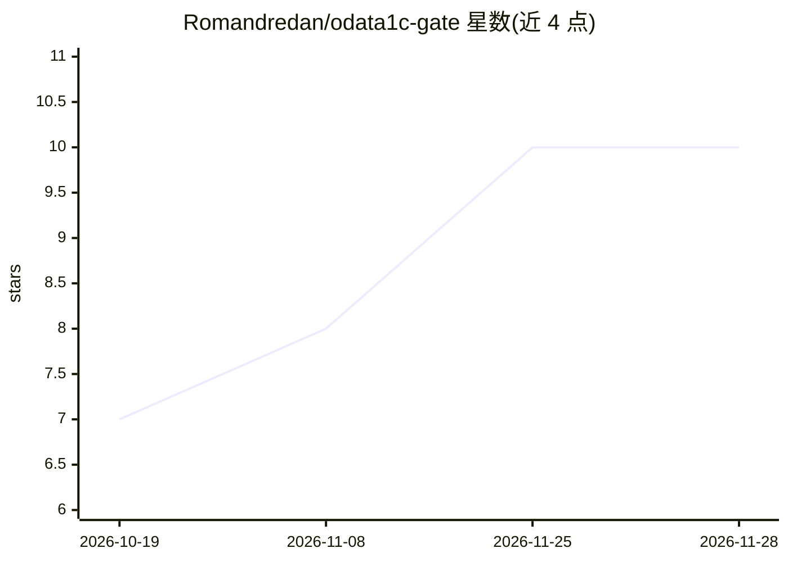

# Romandredan/odata1c-gate

⭐ 10 · Python · MIT · 推送 2026-11-09 · [GitHub](https://github.com/Romandredan/odata1c-gate) · [官网](https://pypi.org/project/odata1c-gate/) · 个人维护

**本地 MCP 网关：让 AI 代理查询 1C OData 而看不到个人数据**

部署在 Claude Code 与 1C:Enterprise 8.3 标准 OData 接口之间的本地 MCP 网关：模型可读取目录、单据与登记簿，写库需人工确认，且支持回滚与日志。核心机制是在数据进入模型上下文之前，将 INN、账号、电话、姓名等替换为确定性令牌，令牌仍可用于搜索、过滤与关联；机主可在终端用 reveal 命令还原真实值。面向需要让 AI 代理访问真实 1C 数据库、同时避免个人数据发送给模型提供商的用户。文档与提示为俄语。

## 筛选速览

| 维度 | 判定 | 备注 |
|---|---|---|
| AI 角色 | `ai-ecosystem` | LLM/agent 周边工具 |
| 许可风险 | `permissive` | MIT |
| 部署形态 | `library` | 以包/库形式分发 |
| 模型依赖 | locked-api |  |
| 硬件要求 | — | 无带数字的原话,不猜 |
| 安装摩擦 | `low` | 无编译、无系统依赖或容器化 |
| 成熟度 | — | 结构信号不足 |

## 能力要点

- 确定性令牌伪名化：同一值始终映射同一令牌，令牌可参与搜索/过滤/连接
- 按库角色（prod/test/dev）分级保护与写权限，规则可按字段自定义
- 写操作走预览+人工确认流程，支持回滚与操作日志
- 为 УТ/БП/ЗУП 典型配置内置查询配方，支持保存对话中的查询为配方

## 适用场景

- 让 Claude Code 以自然语言查询真实 1C 库的库存、应收、工资等数据
- 生产库只读保护、测试与开发库按不同等级开放给 AI 代理
- 避免 INN、账号、姓名等个人数据离开本机发送给模型提供商

## 场景标签

`数据分析` · 领域:效率与自动化

## 证据(README 行号)

> L17: MCP-шлюз между Claude Code и стандартным OData-интерфейсом 1С:Предприятие 8.3. Модель читает
> L27: клиент — Claude Code; как работают другие клиенты MCP, сказано в разделе «Ограничения».

## 星数曲线

2026-10-19 7 → 2026-11-28 10（+3）

---
*卡片 v1 · prompt 1.4 · 生成 2026-11-24 · 置信度 high · 依据 README sha `dd955600a0d1` · [字段定义](../../DATASET.md)*
