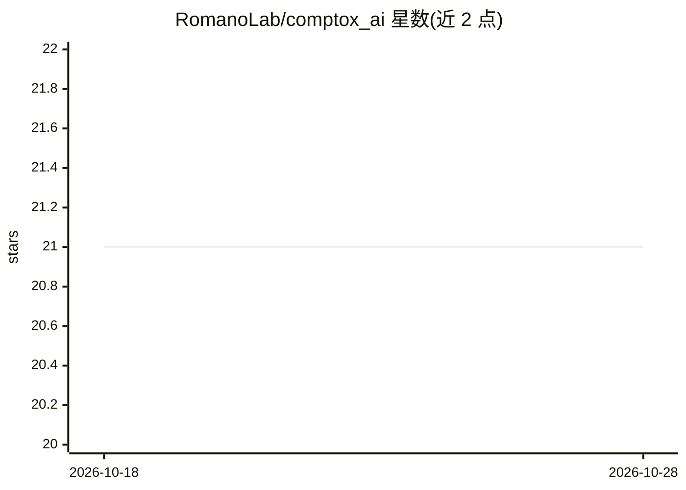

# RomanoLab/comptox_ai

⭐ 21 · Python · NOASSERTION · 推送 2026-08-15 · [GitHub](https://github.com/RomanoLab/comptox_ai) · [官网](https://comptox.ai/) · 组织维护

**计算毒理学 AI 研究的知识图谱与机器学习工具包**

宾夕法尼亚大学 Romano Lab 维护的计算毒理学数据基础设施，包含知识图谱数据库、网站、REST API、图机器学习工具包及杂项工具。知识图谱存于 Neo4j，可两种方式使用：直接 git clone 后 pip 安装以分析现有图谱，或用 conda/mamba 环境自行从数据源构建图谱并装入 Neo4j（含 ista 构建命令）。图机构建文档尚待完善，需通过 Issue 或邮件联系。项目由多项 NIH 基金资助。

## 筛选速览

| 维度 | 判定 | 备注 |
|---|---|---|
| AI 角色 | `ai-knowledge` | 知识聚合/清单类 |
| 许可风险 | `none` | NOASSERTION |
| 部署形态 | `library` | 以包/库形式分发 |
| 模型依赖 | — | README 未给出锁定关系 |
| 硬件要求 | — | 无带数字的原话,不猜 |
| 安装摩擦 | `low` | 无编译、无系统依赖或容器化 |
| 成熟度 | — | 结构信号不足 |

## 能力要点

- 知识图谱数据库配套 REST API、网站与图机器学习工具包
- 知识图谱基于 Neo4j 图数据库
- 支持分析现有图谱或从源头自行构建两种安装路径

## 适用场景

- 毒理学 AI 研究中做图机器学习分析
- 查询化学品—疾病—表型关联的知识图谱
- 基于图谱构建自定义 AI 应用

## 场景标签

`知识图谱` `科研工具` · 领域:知识与检索

## 证据(README 行号)

> L11: A modern data infrastructure for AI research in computational toxicology.
> L13: ComptoxAI is a collection of resources made to enable a diverse range of artificial intelligence applications for c

## 星数曲线

2026-10-18 21 → 2026-10-28 21（+0）

---
*卡片 v1 · prompt 1.4 · 生成 2026-10-28 · 置信度 mid · 依据 README sha `35d0a8c96e5b` · [字段定义](../../DATASET.md)*
