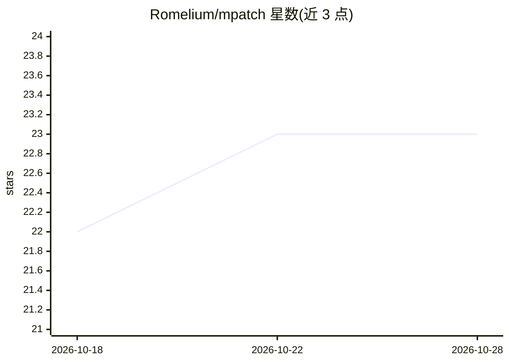

# Romelium/mpatch

⭐ 23 · Rust · MIT · 推送 2026-10-24 · [GitHub](https://github.com/Romelium/mpatch) · [官网](https://docs.rs/mpatch/latest/mpatch/) · 个人维护

**按上下文模糊匹配应用 diff 的 CLI，专处理 LLM 生成的补丁**

mpatch 是用 Rust 编写的补丁应用工具，提供 CLI、Rust 库与 Python 绑定。它不信任行号，通过模糊匹配按相似度评分把 diff hunk 应用到最可能的位置，专为行号常出错的 LLM diff（ChatGPT/Gemini/Claude）设计，也支持 Markdown 代码块、统一 diff、Aider 块与冲突标记等格式。匹配不确定时不改动并报告原因；不处理重命名、二进制补丁与 context diff。

## 筛选速览

| 维度 | 判定 | 备注 |
|---|---|---|
| AI 角色 | `ai-ecosystem` | LLM/agent 周边工具 |
| 许可风险 | `permissive` | MIT |
| 部署形态 | `desktop` | 安装包/桌面程序 |
| 模型依赖 | — | README 未给出锁定关系 |
| 硬件要求 | — | 无带数字的原话,不猜 |
| 安装摩擦 | `low` | 无编译、无系统依赖或容器化 |
| 成熟度 | — | 结构信号不足 |

## 能力要点

- 模糊匹配按相似度（默认 0.7 阈值，-f 可调）定位 hunk，不确定即失败并说明原因
- 支持 Markdown diff 块、统一 diff、Aider search/replace 块、冲突标记等格式自动识别
- 重新缩进、识别 `// ... existing code ...` 占位符、重复应用时跳过已存在改动
- 可作为 Rust/Python 库嵌入编辑器或 coding agent，失败 hunk 可回传模型请求修正

## 适用场景

- 把 ChatGPT/Claude 回复里的 diff 直接应用到项目代码
- 代码过期、行号漂移导致 git apply/patch 失败时应用改动
- 在 coding agent 中嵌入库形式补丁应用并回报失败原因

## 场景标签

 · 领域:开发者工具/代码补丁

## 证据(README 行号)

> L13: It was built for diffs written by **LLMs (ChatGPT, Gemini, Claude)**, which often get line numbers wrong, drop line
> L161: Use the library to build `mpatch` into an editor, a coding agent, or another tool.
> L217: Each failed hunk comes with its reason: no matching location, a best match below the threshold (with its location 

## 星数曲线

2026-10-18 22 → 2026-10-28 23（+1）

---
*卡片 v1 · prompt 1.4 · 生成 2026-10-27 · 置信度 high · 依据 README sha `02e0cd149888` · [字段定义](../../DATASET.md)*
