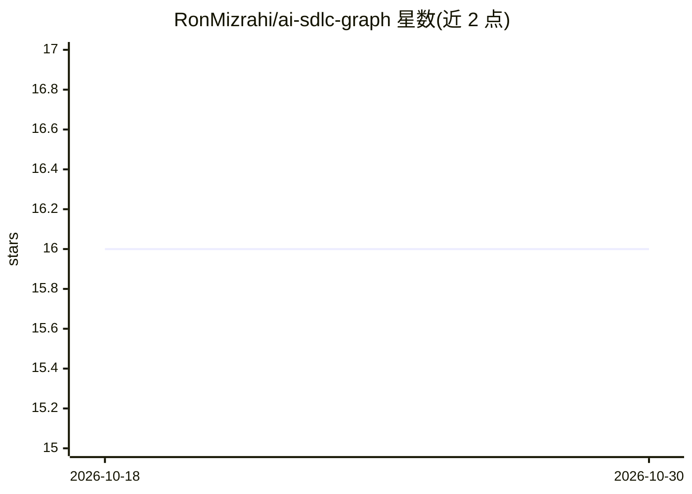

# RonMizrahi/ai-sdlc-graph

⭐ 16 · Python · MIT · 推送 2026-09-21 · [GitHub](https://github.com/RonMizrahi/ai-sdlc-graph) · 个人维护

**驱动编码 agent 执行软件生命周期的可执行无代码 SDLC 图**

以三个 Markdown 文件定义的带守卫状态机，供 Claude Code 等编码 agent 执行从规格到合并的完整软件生命周期：20 个节点、40 条守卫转换、有界重试循环，每次转换先写入持久化 state.json 以支持崩溃后恢复。每个里程碑生成独立 milestone agent 完成构建-评审循环，编排器依据 git、测试套件与 agent 日志核验后才记录转换；未运行的门禁记入 append-only 台账而非标记通过。含 sdlc-graph-viewer 观测视图，通过 Claude Code 插件市场安装，无 npm、无运行时依赖。

## 筛选速览

| 维度 | 判定 | 备注 |
|---|---|---|
| AI 角色 | `ai-ecosystem` | LLM/agent 周边工具 |
| 许可风险 | `permissive` | MIT |
| 部署形态 | `library` | 以包/库形式分发 |
| 模型依赖 | locked-api |  |
| 硬件要求 | — | 无带数字的原话,不猜 |
| 安装摩擦 | `low` | 无编译、无系统依赖或容器化 |
| 成熟度 | — | 结构信号不足 |

## 能力要点

- 20 节点 40 条守卫转换的状态机，图定义为三个 Markdown 文件可编辑
- 每次转换前写入 state.json，运行可从 "where were we?" 恢复
- 每个里程碑派生独立 agent，编排器核验 git/测试/日志后才记录转换
- 未运行门禁记入 append-only 台账，节点不可标记为通过

## 适用场景

- 让编码 agent 从需求一路自动跑到 PR 与合并前的 QA 验证
- 团队按自己的完成定义定制 SDLC 节点与守卫
- 审计一次运行中哪些门禁被跳过或失败

## 场景标签

`编码 Agent` `工作流自动化` · 领域:效率与自动化

## 证据(README 行号)

> L3: The software lifecycle as a **guarded graph your coding agent can actually execute** — typed nodes,
> L61: The work itself does not happen in the orchestrator's context. **A milestone agent is spawned per

## 星数曲线

2026-10-18 16 → 2026-10-30 16（+0）

---
*卡片 v1 · prompt 1.4 · 生成 2026-10-30 · 置信度 mid · 依据 README sha `474232058462` · [字段定义](../../DATASET.md)*
