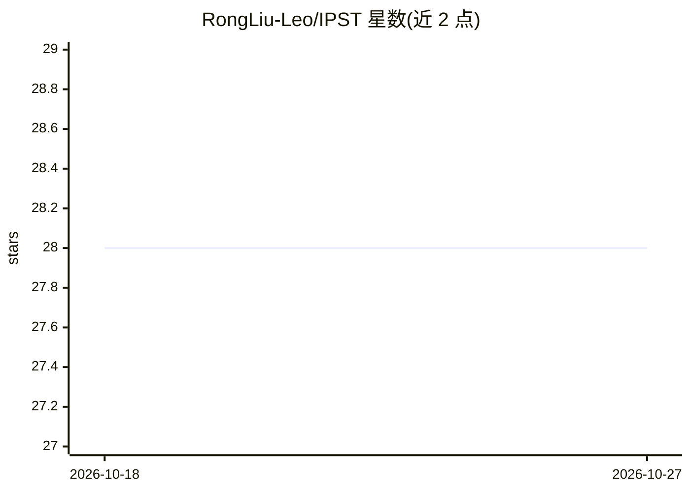

# RongLiu-Leo/IPST

⭐ 28 · Python · 推送 2026-02-10 · [GitHub](https://github.com/RongLiu-Leo/IPST) · [官网](https://rongliu-leo.github.io/IPST/) · 个人维护

**图像/视频照片级风格迁移方法，秒级完成无需预训练**

即时照片级风格迁移（IPST）研究项目：用轻量 StyleNet 将风格图像迁移到内容图像并保留非颜色信息，无需成对数据集预训练或额外约束；通过实例自适应优化提升照片级真实感并在数秒内完成训练。支持图像、视频与 NeRF 等多帧输入的迁移，保持时序与多视角一致性。需 NVIDIA 显卡与 CUDA，从源码克隆并经 conda/pip 安装依赖运行。

## 筛选速览

| 维度 | 判定 | 备注 |
|---|---|---|
| AI 角色 | `ai-native` | 本体是模型或模型工具 |
| 许可风险 | `none` | — |
| 部署形态 | `library` | 以包/库形式分发 |
| 模型依赖 | — | README 未给出锁定关系 |
| 硬件要求 | — | 无带数字的原话,不猜 |
| 安装摩擦 | `medium` | 含编译或系统依赖之一 |
| 成熟度 | — | 结构信号不足 |

## 能力要点

- 无需成对数据集预训练与额外约束的照片级风格迁移
- 轻量 StyleNet，实例自适应优化数秒完成训练
- 视频与 NeRF 多帧迁移保持时序/多视角一致性
- 提供图像与视频（含逐帧降内存模式）迁移命令

## 适用场景

- 给图像套用另一张风格图的照片级色调
- 对视频整体做风格迁移且保持帧间一致
- 作为论文方法复现与后续研究的代码基础

## 场景标签

`图像视频处理` · 领域:感知与多模态

## 证据(README 行号)

> L7: instant photorealistic style transfer on super-resolution inputs without the need for pre-training on pair-wise data
> L9: Moreover, IPST is well-suited for multi-frame style transfer tasks, as it retains temporal and multi-view consistenc

## 星数曲线

2026-10-18 28 → 2026-10-27 28（+0）

---
*卡片 v1 · prompt 1.4 · 生成 2026-10-26 · 置信度 mid · 依据 README sha `0d4f5b41eb63` · [字段定义](../../DATASET.md)*
