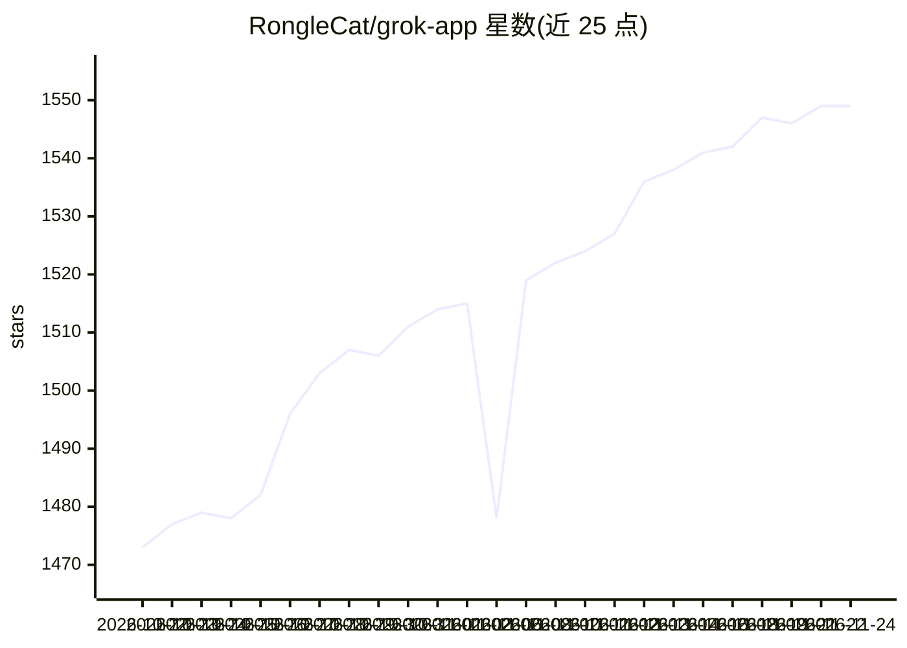

# RongleCat/grok-app

⭐ 1,549 · TypeScript · MIT · 推送 2026-11-17 · [GitHub](https://github.com/RongleCat/grok-app) · [官网](https://grok-app.com) · 个人维护 · 中文 README

**本地 Grok Build CLI 的开源桌面工作台（GUI）**

基于 Tauri 2 的非官方桌面客户端，为本地 Grok Build CLI（`grok agent stdio`，ACP 协议）提供图形界面：多项目隔离工作区、Agent 实时流式时间线、分级权限控制（Ask/单次/会话/YOLO）、CodeMirror 编辑器与 Git Diff 审查、媒体预览、桌面宠物状态反馈。通过桥接 11+ IM 渠道（飞书、Telegram、Discord、微信、QQ 等）实现远程监控与操控，并提供本地回环 REST API。不捆绑专有模型后端，需安装 Grok CLI（0.2.112+）方可使用完整 Agent 能力。

## 筛选速览

| 维度 | 判定 | 备注 |
|---|---|---|
| AI 角色 | `ai-ecosystem` | LLM/agent 周边工具 |
| 许可风险 | `permissive` | MIT |
| 部署形态 | `desktop` | 安装包/桌面程序 |
| 模型依赖 | locked-api |  |
| 硬件要求 | — | 无带数字的原话,不猜 |
| 安装摩擦 | `medium` | 含编译或系统依赖之一 |
| 成熟度 | — | 结构信号不足 |

## 能力要点

- 通过 ACP 协议深度集成 `grok agent stdio`，实时流式展示思考、工具执行与回复
- 11+ IM 渠道桥接（飞书/Telegram/Discord/微信/QQ 等）与移动端 Web 镜像远程操控 Agent
- 分级权限体系：Ask / Allow Once / Allow for Session / YOLO，支持工作区沙箱
- 本地回环 REST 会话 API 供脚本、CI 与第三方工具调用

## 适用场景

- 在图形界面中管理多个项目的 Agent 会话与工作区
- 通过 IM 软件远程查看和操控家里电脑上的 Agent 任务
- 用回环 REST API 把 Agent 会话接入脚本或 CI 流程

## 场景标签

`编码 Agent` `AI 助手` · 领域:编码与开发

## 证据(README 行号)

> L28: > **About Grok App:** Grok App is an open-source desktop client and workbench for the local Grok Build CLI (`grok a
> L36: - ⚡ **Native Build Sessions** — Deep integration with `grok agent stdio` via the ACP protocol. Granular permission 
> L39: - 📲 **Omnichannel Remote IM** — Unified bridge connecting your local agent to Feishu/Lark, Telegram, Discord, Slack

## 星数曲线

2026-10-22 1,473 → 2026-11-24 1,549（+76）

---
*卡片 v1 · prompt 1.4 · 生成 2026-11-23 · 置信度 mid · 依据 README sha `9d639df58efe` · [字段定义](../../DATASET.md)*
