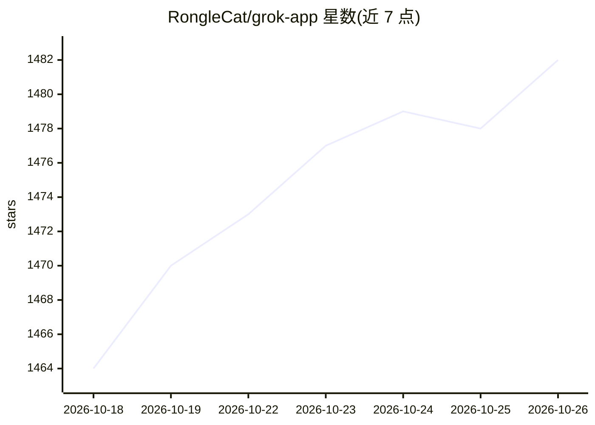

# RongleCat/grok-app

⭐ 1,482 · TypeScript · MIT · 推送 2026-10-22 · [GitHub](https://github.com/RongleCat/grok-app) · [官网](https://grok-app.com) · 个人维护 · 中文 README

**Grok Build CLI 的开源桌面工作台客户端**

基于 Tauri 2 的桌面 GUI，作为本地 Grok Build CLI（grok agent stdio）的工作台：通过 ACP 协议集成多项目工作区、实时 agent 流式输出、CodeMirror 6 编辑器与 Git Diff 审查、媒体预览、Imagine 图像/视频生成、定时自动化、MCP/插件管理，以及 11+ IM 渠道远程桥接。本体不捆绑模型后端，全部推理与工具执行依赖已安装并登录的 grok CLI（0.2.112+）；非官方 xAI 产品。提供 macOS/Windows/Linux 预编译安装包，含中继配置与代理支持。

## 筛选速览

| 维度 | 判定 | 备注 |
|---|---|---|
| AI 角色 | `ai-ecosystem` | LLM/agent 周边工具 |
| 许可风险 | `permissive` | MIT |
| 部署形态 | `desktop` | 安装包/桌面程序 |
| 模型依赖 | — | README 未给出锁定关系 |
| 硬件要求 | — | 无带数字的原话,不猜 |
| 安装摩擦 | `medium` | 含编译或系统依赖之一 |
| 成熟度 | — | 结构信号不足 |

## 能力要点

- 经 ACP 协议深度集成 grok agent stdio，分级权限（Ask/Allow/YOLO）
- 多项目工作区、会话分叉、Git Worktree 集成与看板
- 11+ IM 渠道远程桥接与 token 门控移动网页镜像
- 内置 CodeMirror 6 编辑器、Diff 审查与媒体预览

## 适用场景

- 用图形界面管理和运行本地 Grok CLI 的 agent 会话
- 通过飞书/Telegram/Discord 等远程监控本地 agent
- 多项目并行开发时审查 agent 的文件修改

## 场景标签

`视频生成` `图像生成` · 领域:内容生成

## 证据(README 行号)

> L28: > **About Grok App:** Grok App is an open-source desktop client and workbench for the local Grok Build CLI (`grok a
> L36: - ⚡ **Native Build Sessions** — Deep integration with `grok agent stdio` via the ACP protocol. Granular permission 

## 星数曲线

2026-10-18 1,464 → 2026-10-26 1,482（+18）

---
*卡片 v1 · prompt 1.4 · 生成 2026-10-21 · 置信度 mid · 依据 README sha `e30203f4024b` · [字段定义](../../DATASET.md)*
