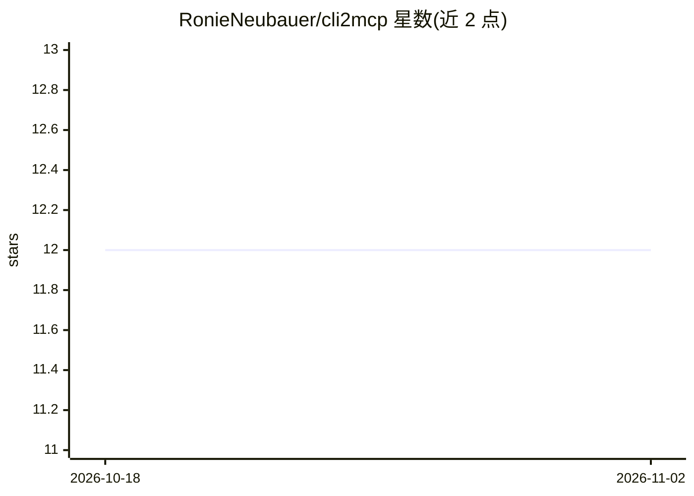

# RonieNeubauer/cli2mcp

⭐ 12 · TypeScript · MIT · 推送 2026-04-29 · [GitHub](https://github.com/RonieNeubauer/cli2mcp) · [官网](https://www.npmjs.com/package/cli2mcp) · 个人维护

**把任意 CLI 一键封装为 MCP 服务器的 Node 工具**

面向使用 MCP 客户端的开发者：通过解析命令行的 --help 输出，在启动时自动合成 JSON Schema，将任意命令行二进制暴露为 MCP 工具，一条命令即可完成，无需手写 SDK 代码。支持 Claude Desktop、ChatGPT、Cursor、Gemini CLI、Cline 等任意 stdio 传输的 MCP 客户端。解析失败时回退为单个变长 args 参数。README 声明为 v0.1 早期版本，仅支持 stdio 传输，API 在 1.0 前可能变化；要求 Node.js 22+，被封装的 CLI 须已安装且在 PATH 上。

## 筛选速览

| 维度 | 判定 | 备注 |
|---|---|---|
| AI 角色 | `ai-ecosystem` | LLM/agent 周边工具 |
| 许可风险 | `permissive` | MIT |
| 部署形态 | `library` | 以包/库形式分发 |
| 模型依赖 | — | README 未给出锁定关系 |
| 硬件要求 | — | 无带数字的原话,不猜 |
| 安装摩擦 | `medium` | 含编译或系统依赖之一 |
| 成熟度 | `idea` | |

## 能力要点

- 解析 --help 自动生成 JSON Schema，新 flag 无需改代码即可被 AI 使用
- 支持任意 stdio MCP 客户端（Claude Desktop/Cursor/Gemini CLI 等）
- 保留 stdin 输入管道，非零退出码以 isError 形式返回 stderr
- 非常规 help 解析失败时回退为变长 args，工具仍可用

## 适用场景

- 让 Claude/Cursor 等 AI 客户端直接调用我已有的命令行工具
- 避免为每个 CLI 手写 80–150 行 MCP 服务器样板代码
- 工具更新 flag 后无需重新发布即可让 AI 看到新参数

## 场景标签

 · 领域:AI 基础设施/MCP 工具

## 证据(README 行号)

> L11: Expose any command-line binary as a Model Context Protocol tool by parsing its `--help` output and synthesizing a J
> L13: Works with **any MCP-compatible client** — Claude Desktop, ChatGPT (via OpenAI Agents SDK), Cursor, Gemini CLI, Cli

## 星数曲线

2026-10-18 12 → 2026-11-02 12（+0）

---
*卡片 v1 · prompt 1.4 · 生成 2026-11-01 · 置信度 high · 依据 README sha `7c11940c5fcc` · [字段定义](../../DATASET.md)*
