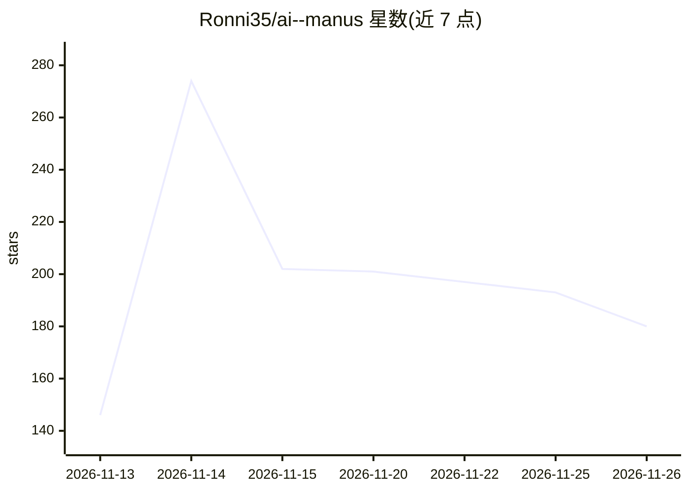

# Ronni35/ai--manus

⭐ 180 · Apache-2.0 · 推送 2026-11-13 · [GitHub](https://github.com/Ronni35/ai--manus) · 个人维护

**面向个人用户的自主 AI Agent：自动执行代码与浏览器操作**

一个自主 AI 代理产品，定位为家庭、学习与轻办公场景的个人助手：用户以自然指令委托任务，代理自行编写并执行脚本、打开网页、与页面元素交互，可跨代码与浏览器完成多步骤任务，并在会话间保持工作流模式。README 仅给出功能描述、系统兼容性表（4GB 内存起步、推荐 8GB）与使用步骤建议，未提供任何安装命令、代码仓库结构或 API 接入细节。主题标签提及 openai/anthropic/gemini/llm 等生态词，但正文未展开。

## 筛选速览

| 维度 | 判定 | 备注 |
|---|---|---|
| AI 角色 | `ai-native` | 本体是模型或模型工具 |
| 许可风险 | `permissive` | Apache-2.0 |
| 部署形态 | `None` |  |
| 模型依赖 | — | README 未给出锁定关系 |
| 硬件要求 | — | 无带数字的原话,不猜 |
| 安装摩擦 | `low` | 无编译、无系统依赖或容器化 |
| 成熟度 | — | 结构信号不足 |

## 能力要点

- 自主执行代码与脚本（Manus code automation）
- 浏览器控制：导航网页、填表、采集信息
- 跨代码与浏览器的多步骤任务编排
- 面向家庭/学习/轻办公的小规模任务场景

## 适用场景

- 让代理代跑重复性脚本与网页操作
- 学习研究中收集资料、整理笔记
- 轻办公场景下从多页面汇总信息

## 场景标签

`AI 助手` `编码 Agent` `浏览器自动化` · 领域:效率与自动化

## 证据(README 行号)

> L10: - **Autonomous Code Execution:** Manus AI agent runs code on its own to complete tasks, so you can focus on decisio
> L18: Manus is an autonomous AI agent designed to run code and control a browser on your behalf. Instead of acting like a

## 星数曲线

2026-11-13 146 → 2026-11-26 180（+34）

---
*卡片 v1 · prompt 1.4 · 生成 2026-11-17 · 置信度 low · 依据 README sha `66ba5de9af15` · [字段定义](../../DATASET.md)*
