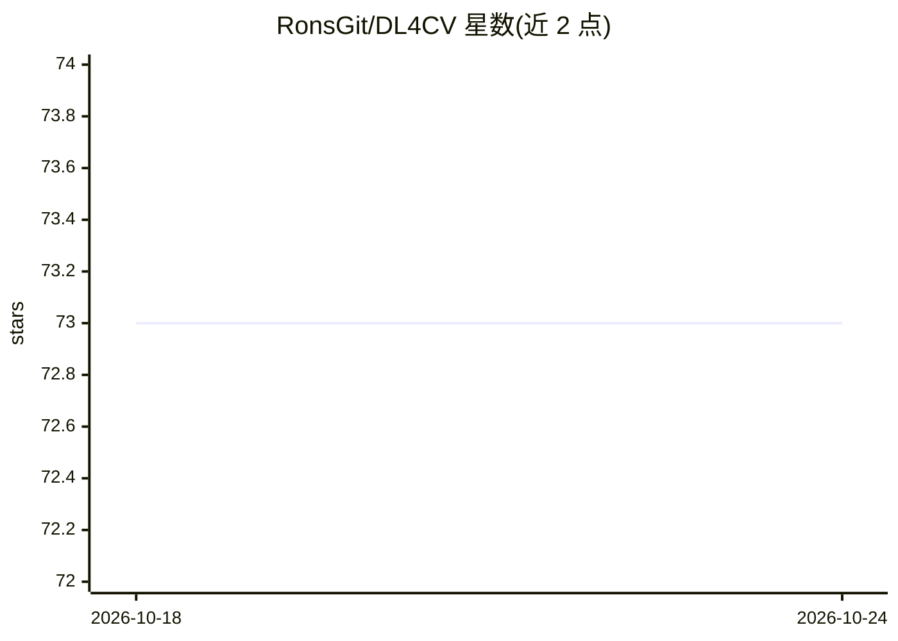

# RonsGit/DL4CV

⭐ 73 · TeX · NOASSERTION · 推送 2026-02-27 · [GitHub](https://github.com/RonsGit/DL4CV) · [官网](https://ronsgit.github.io/DL4CV/) · 个人维护

**面向 CV 初学者的深度学习计算机视觉开源书籍**

社区驱动的计算机视觉深度学习教科书，为入门学生、研究者与从业者提供结构化内容，衔接抽象课程概念、经典论文与实际实现；起源于密歇根大学 EECS498 课程（Justin Johnson）配套资料，后发展为独立社区资源。以在线网站为主要阅读方式，仓库用于跟踪 issue 与技术贡献；本地构建需 TeX 发行版与 Python 3.9+，构建管线针对 Linux/WSL 优化，产出静态 HTML 与 PDF。内容位于 Chapters/ 目录的 .tex 文件中。

## 筛选速览

| 维度 | 判定 | 备注 |
|---|---|---|
| AI 角色 | `ai-knowledge` | 知识聚合/清单类 |
| 许可风险 | `none` | NOASSERTION |
| 部署形态 | `library` | 以包/库形式分发 |
| 模型依赖 | — | README 未给出锁定关系 |
| 硬件要求 | — | 无带数字的原话,不猜 |
| 安装摩擦 | `low` | 无编译、无系统依赖或容器化 |
| 成熟度 | — | 结构信号不足 |

## 能力要点

- 以静态网站为主要阅读载体，无需安装即可阅读
- 本地构建管线读取 .tex 源文件生成静态 HTML 与 PDF
- 内容基于密歇根大学 EECS498 课程并标注引用出处
- 通过 GitHub Releases 打标签发布历史版本

## 适用场景

- 系统学习计算机视觉深度学习的结构化教材
- 作为可回访的长期参考手册
- 参与社区勘误、补充章节或新增内容

## 场景标签

`教程课程` · 领域:学习与行业

## 证据(README 行号)

> L45: **Deep Learning for Computer Vision** is a community-driven open-source initiative designed to create an accessible
> L51: This project originated as a structured companion to the University of Michigan’s EECS498 curriculum by **Ron Korin

## 星数曲线

2026-10-18 73 → 2026-10-24 73（+0）

---
*卡片 v1 · prompt 1.4 · 生成 2026-10-24 · 置信度 mid · 依据 README sha `7b785785cd9a` · [字段定义](../../DATASET.md)*
