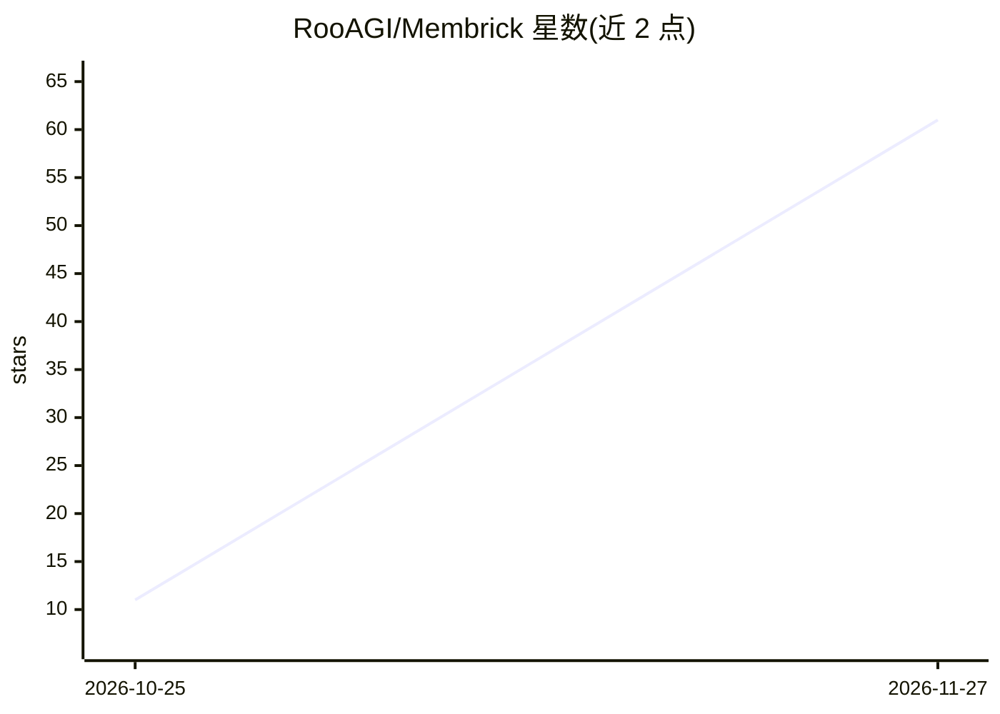

# RooAGI/Membrick

⭐ 61 · Rust · Apache-2.0 · 推送 2026-11-26 · [GitHub](https://github.com/RooAGI/Membrick) · [官网](https://rooagi.github.io/Membrick/) · 组织维护

**给 AI 编码代理提供带时效证据的持久记忆层**

Rust 编写的持久化记忆组件，把项目历史（会话、文档、决策、trace、笔记、代码）转为供代理使用的当前上下文；核心机制是 current-state retrieval，通过相关性、时间与语义关系区分最新结论与被取代的历史记录，并可在无显式元数据时按语义域推断取代关系。提供 CLI（status/review/query/context）、MCP 工具与 Claude Code、Codex、Gemini CLI、AGY、Muse Code 的可选集成，各代理共享同一项目级记忆存储。在 LongMemEval-S（500 题）上发布检索指标与复现脚本。

## 筛选速览

| 维度 | 判定 | 备注 |
|---|---|---|
| AI 角色 | `ai-ecosystem` | LLM/agent 周边工具 |
| 许可风险 | `permissive` | Apache-2.0 |
| 部署形态 | `self-host` | docker 或自建部署 |
| 模型依赖 | — | README 未给出锁定关系 |
| 硬件要求 | — | 无带数字的原话,不猜 |
| 安装摩擦 | `low` | 无编译、无系统依赖或容器化 |
| 成熟度 | — | 结构信号不足 |

## 能力要点

- current-state retrieval：用时间与取代关系区分最新真值与历史
- 支持 Claude Code、Codex、Gemini CLI、AGY、Muse Code 集成与共享 MCP 工具
- 提供 membrick CLI（status/review/query/context）生成 LLM-ready 上下文
- 基于 LongMemEval-S 的可复现基准与数据集/工作流

## 适用场景

- 给 Claude Code/Codex 等 CLI 代理接入跨会话项目记忆
- 项目决策文档多次变更后仍能检索到当前生效的配置或约定
- 检索结果需附带来源与取代关系的证据链

## 场景标签

`Agent 记忆` · 领域:Agent 开发

## 证据(README 行号)

> L14: Membrick is open-source **persistent memory for AI coding agents**. It turns project history — sessions, documents,
> L18: Membrick supports Claude Code, Codex, Gemini CLI, Antigravity CLI (AGY), and Muse Code.
> L137: |Integration|Project memory|Lifecycle capture|MCP tools|Replay / comparison|

## 星数曲线

2026-10-25 11 → 2026-11-27 61（+50）

---
*卡片 v1 · prompt 1.4 · 生成 2026-11-18 · 置信度 mid · 依据 README sha `351afacee6e1` · [字段定义](../../DATASET.md)*
