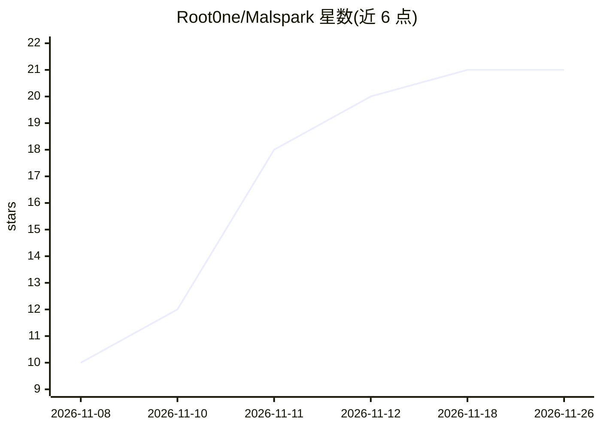

# Root0ne/Malspark

⭐ 21 · Python · MIT · 推送 2026-11-25 · [GitHub](https://github.com/Root0ne/Malspark) · [官网](https://malspark.com) · 个人维护

**自托管多智能体恶意软件分析平台：AI 分析师团队出具带证据的报告**

开源、自托管的恶意软件分析平台：上传样本后，确定性 triage 包先建立事实（哈希、签名、规则引擎、字符串解码），随后多个分析师 agent 使用反编译器、反汇编器、沙箱等真实工具调查，经 mediator 列出矛盾并辩论，由 judge 裁定结论、家族与 ATT&CK 技术。每个论断引用证据账本中的工具调用 id。输出 MITRE ATT&CK 报告（Markdown/HTML/PDF）、STIX 2.1 包、IOC feed 与检测草稿。通过 MCP 接入任意工具服务器，模型与沙箱为配置项；以 Docker Compose 栈方式部署，Web 控制台含六个视图，内置 default/measurement/mobile/deep_static/team_lead 五种团队。

## 筛选速览

| 维度 | 判定 | 备注 |
|---|---|---|
| AI 角色 | `ai-native` | 本体是模型或模型工具 |
| 许可风险 | `permissive` | MIT |
| 部署形态 | `self-host` | docker 或自建部署 |
| 模型依赖 | — | README 未给出锁定关系 |
| 硬件要求 | — | 无带数字的原话,不猜 |
| 安装摩擦 | `low` | 无编译、无系统依赖或容器化 |
| 成熟度 | — | 结构信号不足 |

## 能力要点

- 多 agent 流水线：triage→分析→辩论→裁定→报告，judge 裁定 ATT&CK 技术与结论
- 证据账本机制：每条论断引用带 id 的工具调用记录，封存于运行结果
- 任意 MCP 服务器可为 agent 提供工具，工具、模型、沙箱、团队均为配置
- 输出 ATT&CK 报告、STIX 2.1 包、IOC feed 与检测草稿

## 适用场景

- 上传恶意样本，获得可逐条核验证据的分析报告
- 对 APK/DEX 样本走 mobile 团队流水线分析
- 用自有 MCP 工具服务器扩展 agent 的分析能力

## 场景标签

`多智能体` `网络安全` · 领域:Agent 开发

## 证据(README 行号)

> L13: Malspark is an open-source, self-hosted platform for malware analysis. You
> L14: upload a sample, and a team of AI agents analyses it with real tools such as a
> L33: 4. **A judge decides** the verdict, the family and the ATT&CK techniques, and

## 星数曲线

2026-11-08 10 → 2026-11-26 21（+11）

---
*卡片 v1 · prompt 1.4 · 生成 2026-11-18 · 置信度 high · 依据 README sha `337f6ed6133d` · [字段定义](../../DATASET.md)*
