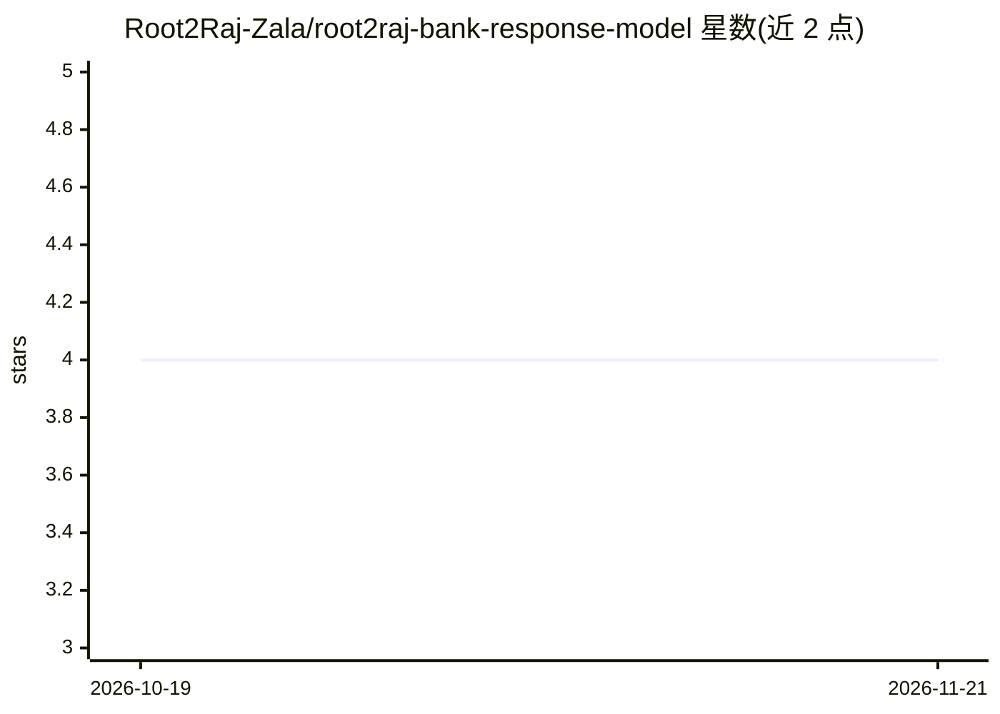

# Root2Raj-Zala/root2raj-bank-response-model

⭐ 4 · Python · NOASSERTION · 推送 2026-10-06 · [GitHub](https://github.com/Root2Raj-Zala/root2raj-bank-response-model) · [官网](https://root2raj.ruturaj1zala123.chatgpt.site/projects/bank-response-model/) · 个人维护

**银行营销响应分类的模型风险评估案例研究**

基于 UCI 41,188 条葡萄牙银行营销记录的订阅结果分类基准，按时间顺序切分 60/10/10/20 训练、选择、校准与测试块，比较逻辑回归与受限随机森林，并在独立校准块上做 sigmoid 概率校准。排除通话时长与人口统计学变量以防捷径，报告后段 8,238 条记录上的指标与分布偏移证据。明确声明不用于真实客户决策，属个人作品集项目，提供复现材料。

## 筛选速览

| 维度 | 判定 | 备注 |
|---|---|---|
| AI 角色 | `ai-native` | 本体是模型或模型工具 |
| 许可风险 | `none` | NOASSERTION |
| 部署形态 | `None` |  |
| 模型依赖 | — | README 未给出锁定关系 |
| 硬件要求 | — | 无带数字的原话,不猜 |
| 安装摩擦 | `low` | 无编译、无系统依赖或容器化 |
| 成熟度 | — | 结构信号不足 |

## 能力要点

- 按时间顺序划分数据块，训练/选择/校准/测试互不重叠
- 排除通话时长与人口统计、宏观变量，防止捷径特征
- 独立校准块上拟合 sigmoid 校准，测试集报告原始与校准后指标
- 公开聚合排名与可靠性表，不发布个体客户特征或预测

## 适用场景

- 复现带分布偏移的二分类评估流程
- 学习概率校准与时间序列式数据切分实践
- 作为模型风险文档化（model card、决策简报）的示例

## 场景标签

`模型评测` · 领域:评测与运维

## 证据(README 行号)

> L7: Can campaign context rank subscription outcomes without using the duration of the call being predicted? This benchma
> L26: 1. Preserve input order. Use 60% training, 10% model selection, 10% independent sigmoid calibration and the final 2

## 星数曲线

2026-10-19 4 → 2026-11-21 4（+0）

---
*卡片 v1 · prompt 1.4 · 生成 2026-11-21 · 置信度 mid · 依据 README sha `6e22f1d79aa6` · [字段定义](../../DATASET.md)*
