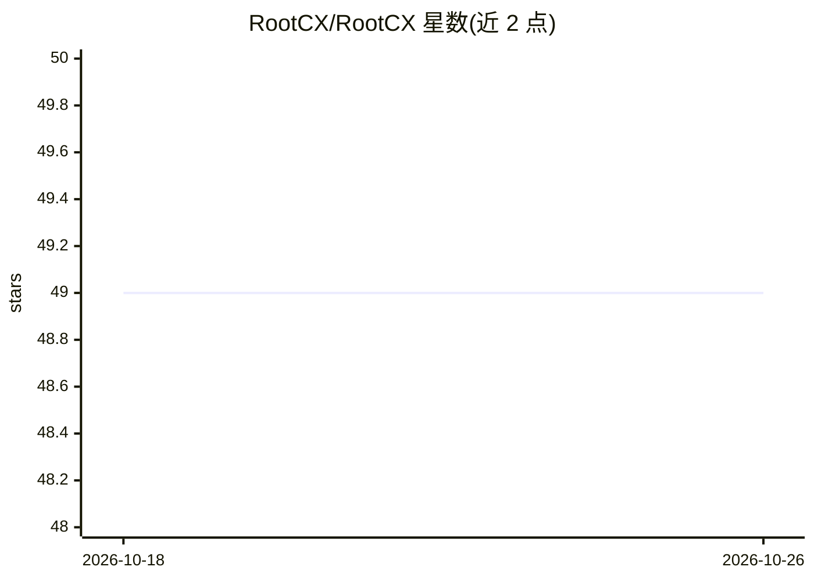

# RootCX/RootCX

⭐ 49 · Rust · NOASSERTION · 推送 2026-10-25 · [GitHub](https://github.com/RootCX/RootCX) · [官网](https://rootcx.com) · 组织维护

**给 AI 编写的内部工具提供治理化部署运行的自托管平台**

面向用 Claude Code、Codex、Cursor 等 AI 编码工具构建内部工具的团队：部署一次 RootCX Core（单个 Docker 镜像或云端），每个工具即获得共享 PostgreSQL 与自动 CRUD API、OIDC SSO 与命名空间 RBAC、全量审计日志、AES-256 加密密钥库、cron 调度、pgmq 消息队列、20+ 集成，以及面向 agent 的工具暴露与 MCP 服务器接入。CLI 通过 rootcx init 一条命令完成脚手架与部署；应用源码、构建与部署保留在本地。许可为 FSL-1.1-ALv2，禁止用于竞品，两年后转 Apache 2.0。

## 筛选速览

| 维度 | 判定 | 备注 |
|---|---|---|
| AI 角色 | `ai-ecosystem` | LLM/agent 周边工具 |
| 许可风险 | `none` | NOASSERTION |
| 部署形态 | `library` | 以包/库形式分发 |
| 模型依赖 | — | README 未给出锁定关系 |
| 硬件要求 | — | 无带数字的原话,不猜 |
| 安装摩擦 | `low` | 无编译、无系统依赖或容器化 |
| 成熟度 | — | 结构信号不足 |

## 能力要点

- 一条 rootcx init 命令完成脚手架到部署（云端或自托管）
- 共享 PostgreSQL 自动生成 CRUD API，无 ORM 与迁移
- OIDC SSO、命名空间 RBAC、含 before/after diff 的全量审计日志
- 每个应用向 agent 暴露工具（query/mutate/describe），可接入任意 MCP 服务器

## 适用场景

- 用 AI 编码工具快速产出内部工具并直接落到统一治理平台
- 企业内多个内部工具集中管理权限、审计与密钥
- 把 agent 连接到 Telegram、Slack、邮件等渠道并管控其数据操作

## 场景标签

 · 领域:企业内部工具/开发者平台

## 证据(README 行号)

> L7:  Build internal tools with Claude Code. Ship them with enterprise governance.
> L29: You keep coding exactly like you do today. Same AI tools, same freedom. RootCX is just the production layer underne
> L31: Deploy Core once (one Docker image or Cloud). Every internal tool you build lands on the same governed platform wit

## 星数曲线

2026-10-18 49 → 2026-10-26 49（+0）

---
*卡片 v1 · prompt 1.4 · 生成 2026-10-24 · 置信度 mid · 依据 README sha `da61a18c3ccd` · [字段定义](../../DATASET.md)*
