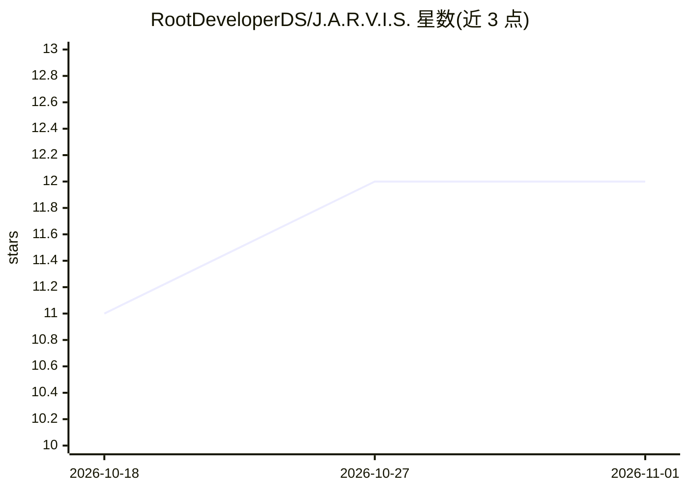

# RootDeveloperDS/J.A.R.V.I.S.

⭐ 12 · Python · NOASSERTION · 推送 2026-09-26 · [GitHub](https://github.com/RootDeveloperDS/J.A.R.V.I.S.) · 个人维护

**桌面端语音 AI 个人助手，基于 Gemini API 的对话与自动化**

Python + CustomTkinter 构建的桌面个人 AI 助手，灵感来自钢铁侠的 JARVIS。核心能力：Gemini API 驱动的对话（带 20 轮上下文记忆与持久化聊天记录）、SpeechRecognition 语音识别与 pyttsx3 语音合成、支持英语和印地语；功能覆盖自然语言提醒、笔记、自定义命令、音乐播放、天气/新闻/股价展示、语音控制开关机等系统命令与网页/应用打开，并提供模块化插件系统。安装需克隆仓库、pip 安装依赖并配置 GEMINI_API_KEY，可选天气与新闻 API。

## 筛选速览

| 维度 | 判定 | 备注 |
|---|---|---|
| AI 角色 | `ai-native` | 本体是模型或模型工具 |
| 许可风险 | `none` | NOASSERTION |
| 部署形态 | `library` | 以包/库形式分发 |
| 模型依赖 | — | README 未给出锁定关系 |
| 硬件要求 | — | 无带数字的原话,不猜 |
| 安装摩擦 | `low` | 无编译、无系统依赖或容器化 |
| 成熟度 | — | 结构信号不足 |

## 能力要点

- Gemini API 对话引擎，20 轮上下文记忆与持久化聊天记录
- 语音识别、唤醒词与 pyttsx3 语音合成，支持英语/印地语
- 语音/文本控制系统开关机、应用与网页打开
- 模块化插件系统，plugins/ 目录自动加载

## 适用场景

- 用语音或文字与本地桌面 AI 助手对话并完成日常任务
- 设置自然语言提醒和管理笔记
- 教助手自定义命令实现个人自动化

## 场景标签

`AI 助手` `语音 Agent` · 领域:对话与助手

## 证据(README 行号)

> L31: - **Gemini API Integration** – Powered by Google's Gemini AI for intelligent conversations
> L94: - **Google Gemini API** – AI conversation engine

## 星数曲线

2026-10-18 11 → 2026-11-01 12（+1）

---
*卡片 v1 · prompt 1.4 · 生成 2026-11-01 · 置信度 high · 依据 README sha `96cff741b009` · [字段定义](../../DATASET.md)*
