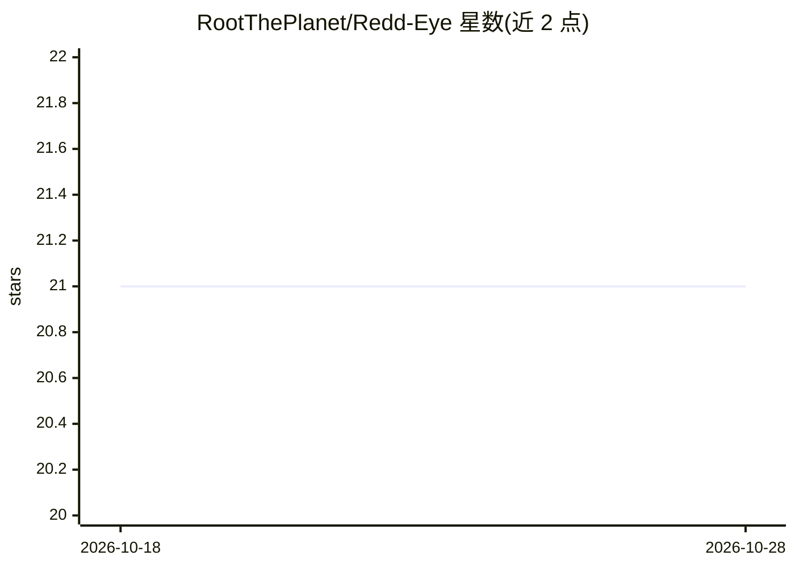

# RootThePlanet/Redd-Eye

⭐ 21 · JavaScript · MIT · 推送 2026-04-16 · [GitHub](https://github.com/RootThePlanet/Redd-Eye) · [官网](http://reddit.com) · 个人维护

**标记 Reddit 上疑似 AI 内容与机器人账号的浏览器扩展**

面向 Reddit 用户的 Chrome/Firefox 浏览器扩展：浏览时实时扫描帖子和评论，用写作风格启发式（低突发性、过度正式、重复语言模式等统计信号）为 AI 生成内容打分，用用户名与行为相关指标识别机器人账号，在页面上以置信度高亮标记，悬停可查看评分明细与触发的检查项。AI 与机器人阈值可在设置面板调整（默认 2.5/2.9）。商店上架尚未发布，需以开发者方式本地安装；Firefox 临时加载重启后失效。

## 筛选速览

| 维度 | 判定 | 备注 |
|---|---|---|
| AI 角色 | `ai-native` | 本体是模型或模型工具 |
| 许可风险 | `permissive` | MIT |
| 部署形态 | `library` | 以包/库形式分发 |
| 模型依赖 | — | README 未给出锁定关系 |
| 硬件要求 | — | 无带数字的原话,不猜 |
| 安装摩擦 | `low` | 无编译、无系统依赖或容器化 |
| 成熟度 | `idea` | |

## 能力要点

- AI 写作风格启发式打分（低突发性、重复语言模式等统计信号）
- 机器人账号行为与用户名指标检测
- 页面上置信度高亮，悬停查看评分明细与触发检查项
- 可调的 AI/机器人检测阈值（默认 2.5/2.9）

## 适用场景

- 浏览 Reddit 时快速识别疑似 AI 生成的帖子和评论
- 识别疑似机器人账号以判断内容可信度
- 通过评分明细自行核查标记原因并调整灵敏度

## 场景标签

 · 领域:浏览器扩展/AI 检测

## 证据(README 行号)

> L16: Redd-Eye is a browser extension for Reddit that flags content likely to be AI-generated and highlights accounts tha
> L26: - **AI-content detection:** Scores writing style signals such as low burstiness, over-formal phrasing, repetitive l

## 星数曲线

2026-10-18 21 → 2026-10-28 21（+0）

---
*卡片 v1 · prompt 1.4 · 生成 2026-10-28 · 置信度 mid · 依据 README sha `4f1590938a63` · [字段定义](../../DATASET.md)*
