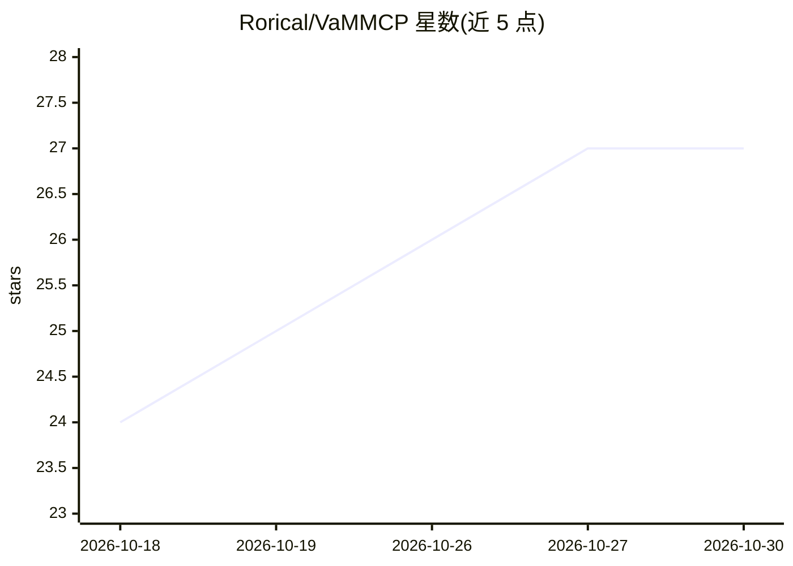

# Rorical/VaMMCP

⭐ 27 · C# · MIT · 推送 2026-08-20 · [GitHub](https://github.com/Rorical/VaMMCP) · 个人维护 · 中文 README

**让 MCP 客户端用自然语言控制 Virt-A-Mate 的 BepInEx 插件（63 工具）**

以 BepInEx 插件形式运行在 Virt-A-Mate 进程内的 MCP 服务器，通过 Streamable HTTP（127.0.0.1:9837/mcp）向任意 MCP 客户端（Claude Code、Codex、Cursor、Claude Desktop 等）暴露 63 个工具，覆盖场景构建、Atom 增删、角色外观/服装/发型、姿势与表情、骨骼控制、参数读写、相机截图、Hub 内容浏览下载与 VaM 插件管理。HTTP 线程经主线程分发器进入 Unity 主线程。要求 VaM 1.20+ 与 BepInEx 5.4.x，服务器仅绑定回环地址、无身份验证，eval_cs 默认关闭。非官方社区项目。

## 筛选速览

| 维度 | 判定 | 备注 |
|---|---|---|
| AI 角色 | `ai-ecosystem` | LLM/agent 周边工具 |
| 许可风险 | `permissive` | MIT |
| 部署形态 | `desktop` | 安装包/桌面程序 |
| 模型依赖 | — | README 未给出锁定关系 |
| 硬件要求 | — | 无带数字的原话,不猜 |
| 安装摩擦 | `medium` | 含编译或系统依赖之一 |
| 成熟度 | — | 结构信号不足 |

## 能力要点

- 进程内 MCP 服务器，Streamable HTTP 直连，无 Python 无 side-car
- 63 个工具覆盖场景/角色/服装/骨骼/相机/Hub/插件管理
- 通用参数层可读写任意 JSONStorable 参数，覆盖 UI 全部滑杆
- HTTP 仅绑定 127.0.0.1 并校验 Origin，eval_cs 默认关闭

## 适用场景

- 让 Claude Code/Codex/Cursor 等客户端用自然语言操作 VaM 搭建场景与调角色
- 通过 MCP 自动化批量管理 VaM 插件与 Hub 内容下载
- 程序化做姿势、表情与相机截图的工作流

## 场景标签

`工作流自动化` · 领域:效率与自动化

## 证据(README 行号)

> L14: **The MCP server runs inside the BepInEx plugin, in the VaM process**, over Streamable HTTP
> L19: MCP client ──HTTP/JSON-RPC──▶ VaMMCP (BepInEx plugin, inside the VaM process)

## 星数曲线

2026-10-18 24 → 2026-10-30 27（+3）

---
*卡片 v1 · prompt 1.4 · 生成 2026-10-26 · 置信度 high · 依据 README sha `71b6a6109e9f` · [字段定义](../../DATASET.md)*
