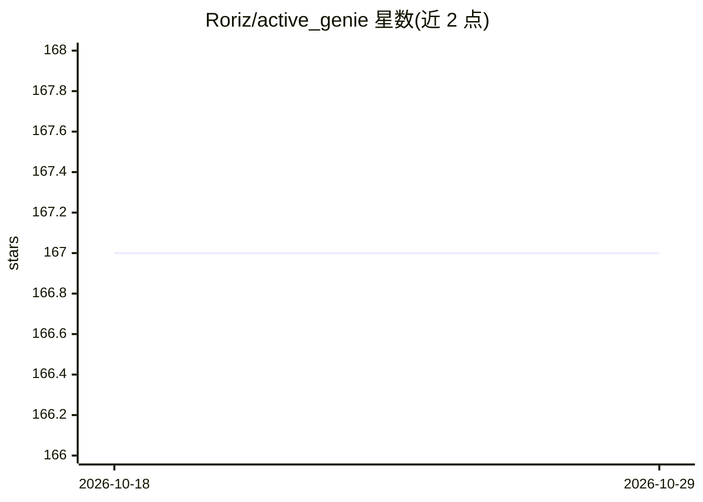

# Roriz/active_genie

⭐ 167 · Ruby · Apache-2.0 · 推送 2026-08-12 · [GitHub](https://github.com/Roriz/active_genie) · [官网](https://activegenie.ai/) · 个人维护

**Ruby 的 GenAI 功能工具包：模型无关的比较/评分/排序模块**

面向 Ruby 开发者的 GenAI 功能构建工具包，提供 Scorer（领域专家陪审团评分）、Comparator（结构化辩论裁决主观比较）、Ranker（锦标赛机制排序大数据集）、Lister（列表生成）四个模型无关模块，各模块返回含 data、reasoning、metadata 的 Result 对象。结果一致性依赖基准测试、借鉴人类推理技巧的提示词与单一用途的专用提示词。需 Ruby 3.4.0 以上及 OpenAI/Anthropic/DeepSeek/Google 任一 API key，以 gem 形式安装。

## 筛选速览

| 维度 | 判定 | 备注 |
|---|---|---|
| AI 角色 | `ai-ecosystem` | LLM/agent 周边工具 |
| 许可风险 | `permissive` | Apache-2.0 |
| 部署形态 | `None` |  |
| 模型依赖 | — | README 未给出锁定关系 |
| 硬件要求 | — | 无带数字的原话,不猜 |
| 安装摩擦 | `low` | 无编译、无系统依赖或容器化 |
| 成熟度 | — | 结构信号不足 |

## 能力要点

- Scorer/Comparator/Ranker/Lister 四个模型无关模块
- 以辩论、陪审团等推理式提示词机制组织模型输出
- 每个版本与模型更新经基准测试验证一致性
- 统一 Result 对象（data/reasoning/metadata）

## 适用场景

- 在 Ruby/Rails 应用中加入 AI 评分与内容比较功能
- 对大量候选项按自定义标准排序
- 生成结构化列表（如产品特征清单）

## 场景标签

 · 领域:LLM 应用开发/工具库

## 证据(README 行号)

> L7: **ActiveGenie** is a toolkit for building GenAI features in Ruby. Its modules are model-agnostic and work across pro
> L18: - An API key for OpenAI, Anthropic, DeepSeek, or Google

## 星数曲线

2026-10-18 167 → 2026-10-29 167（+0）

---
*卡片 v1 · prompt 1.4 · 生成 2026-10-23 · 置信度 high · 依据 README sha `2f68cafed057` · [字段定义](../../DATASET.md)*
