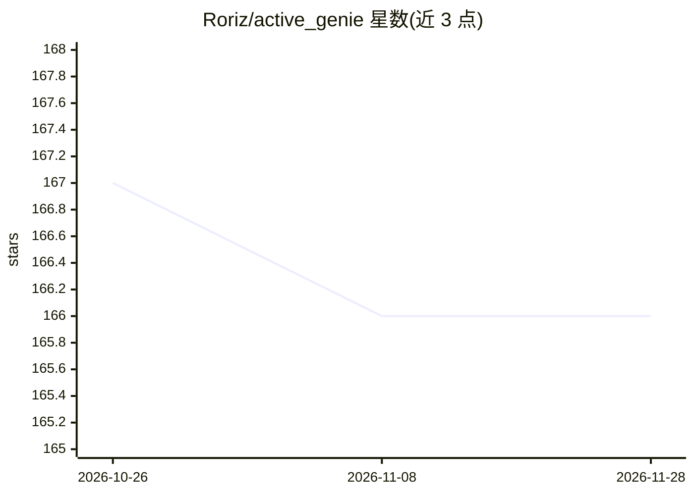

# Roriz/active_genie

⭐ 166 · Ruby · Apache-2.0 · 推送 2026-11-27 · [GitHub](https://github.com/Roriz/active_genie) · [官网](https://activegenie.ai/) · 个人维护

**Ruby 开发者的 GenAI 功能工具库：比较/评分/排序模块**

面向 Ruby 的 GenAI 功能构建工具包，含三个模块：Comparator 通过结构化辩论裁定主观比较、Scorer 以领域专家陪审团方式给内容打分、Ranker 用锦标赛机制对大数据集排序。模型无关，支持多家供应商 API。结果一致性通过版本与模型的基准测试、推理式提示、专用提示实现；每个模块返回含 data/reasoning/metadata 的 Result。需 Ruby >= 3.4.0 与供应商 API key。

## 筛选速览

| 维度 | 判定 | 备注 |
|---|---|---|
| AI 角色 | `ai-ecosystem` | LLM/agent 周边工具 |
| 许可风险 | `permissive` | Apache-2.0 |
| 部署形态 | `None` |  |
| 模型依赖 | — | README 未给出锁定关系 |
| 硬件要求 | — | 无带数字的原话,不猜 |
| 安装摩擦 | `low` | 无编译、无系统依赖或容器化 |
| 成熟度 | — | 结构信号不足 |

## 能力要点

- Comparator/Scorer/Ranker 三个模块分别处理比较、评分、排序
- 模型无关设计，可跨供应商使用
- 内置一致性基准测试与 golden-set 评测流程
- 统一返回含 data、reasoning、metadata 的 Result 对象

## 适用场景

- 在 Ruby/Rails 应用中加入内容评分功能
- 对候选列表按标准做 LLM 排序
- 用 golden-set eval 验证自己 LLM 功能的回归表现

## 场景标签

`模型评测` · 领域:评测与运维

## 证据(README 行号)

> L6: **ActiveGenie** is a toolkit for building GenAI features in Ruby. Its modules are model-agnostic and work across pro
> L17: - An API key for OpenAI, Anthropic, DeepSeek, or Google

## 星数曲线

2026-10-26 167 → 2026-11-28 166（-1）

---
*卡片 v1 · prompt 1.4 · 生成 2026-11-28 · 置信度 high · 依据 README sha `c1a01621c52d` · [字段定义](../../DATASET.md)*
