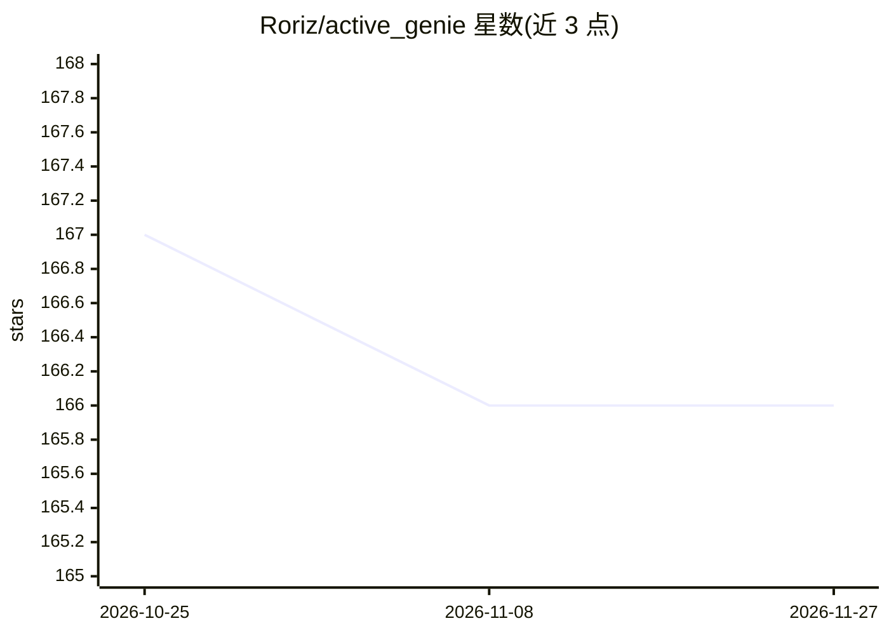

# Roriz/active_genie

⭐ 166 · Ruby · Apache-2.0 · 推送 2026-11-26 · [GitHub](https://github.com/Roriz/active_genie) · [官网](https://activegenie.ai/) · 组织维护

**Ruby 开发者的 GenAI 功能工具库：比较、评分、排序**

ActiveGenie 是用于在 Ruby 中构建 GenAI 功能的工具包，模块与模型无关、可跨提供商使用。核心模块包括：Comparator（通过结构化辩论裁决主观比较）、Scorer（由领域专家陪审团给内容打分）、Ranker（以锦标赛机制对大数据集排序）、Lister（按主题生成列表）。每个模块使用专门提示词，并借助辩论、陪审等人类推理技术塑造模型思考；每次版本与模型更新都会做一致性基准测试。所有模块返回统一的 Result 对象，含 data、reasoning 与 metadata。

## 筛选速览

| 维度 | 判定 | 备注 |
|---|---|---|
| AI 角色 | `ai-ecosystem` | LLM/agent 周边工具 |
| 许可风险 | `permissive` | Apache-2.0 |
| 部署形态 | `None` |  |
| 模型依赖 | — | README 未给出锁定关系 |
| 硬件要求 | — | 无带数字的原话,不猜 |
| 安装摩擦 | `low` | 无编译、无系统依赖或容器化 |
| 成熟度 | — | 结构信号不足 |

## 能力要点

- Comparator/Scorer/Ranker/Lister 四个模型无关模块
- 辩论与陪审等推理提示机制，配一致性基准测试
- 统一返回含 data、reasoning、metadata 的 Result
- 以 Ruby gem 分发，支持 Rails 集成配置

## 适用场景

- 在 Ruby/Rails 项目中接入 LLM 完成内容评分
- 对两条输入做主观比较并得到裁决结果
- 用锦标赛机制对大规模数据集排序

## 场景标签

 · 领域:LLM 基础设施/开发工具

## 证据(README 行号)

> L7: **ActiveGenie** is a toolkit for building GenAI features in Ruby. Its modules are model-agnostic and work across pro
> L18: - An API key for OpenAI, Anthropic, DeepSeek, or Google

## 星数曲线

2026-10-25 167 → 2026-11-27 166（-1）

---
*卡片 v1 · prompt 1.4 · 生成 2026-11-27 · 置信度 high · 依据 README sha `a79724b58dcc` · [字段定义](../../DATASET.md)*
