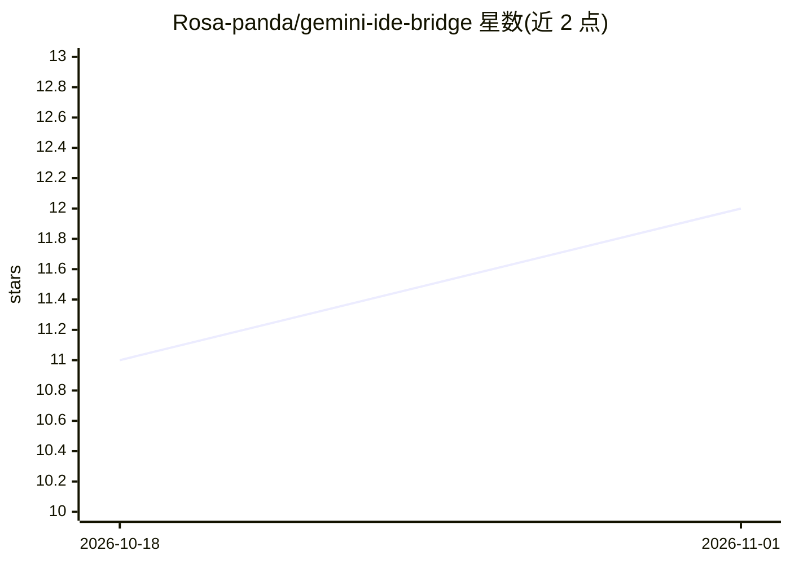

# Rosa-panda/gemini-ide-bridge

⭐ 12 · JavaScript · GPL-3.0 · 推送 2026-03-17 · [GitHub](https://github.com/Rosa-panda/gemini-ide-bridge) · 个人维护 · 中文 README

**把 Gemini 网页接入本地文件系统的 Chrome 插件**

零依赖的原生 JS Chrome 扩展，通过 File System Access API 让网页版 Gemini 直接读写本地文件：解析 AI 输出中的 SEARCH/REPLACE 补丁做增量修改，应用前做括号匹配静态分析拦截语法错误，失败时反馈差异修正建议；IndexedDB 持久化每文件 10 个历史版本支持回滚。内置 VSCode 风格编辑器（30+ 语言高亮、minimap、折叠）、READ 指令按行取码与项目骨架生成以控制上下文。面向想在免费网页 Gemini 上做本地编码的用户，安装为开发者模式加载解包目录，修改源码需 npm install 后 node build.js 重建；绕过输入长度限制功能标注可能不稳定。

## 筛选速览

| 维度 | 判定 | 备注 |
|---|---|---|
| AI 角色 | `ai-ecosystem` | LLM/agent 周边工具 |
| 许可风险 | `viral` | GPL-3.0 |
| 部署形态 | `library` | 以包/库形式分发 |
| 模型依赖 | — | README 未给出锁定关系 |
| 硬件要求 | — | 无带数字的原话,不猜 |
| 安装摩擦 | `low` | 无编译、无系统依赖或容器化 |
| 成熟度 | — | 结构信号不足 |

## 能力要点

- SEARCH/REPLACE 增量补丁解析与精确匹配
- 应用前静态括号分析拦截 AI 语法错误，失败时反馈差异建议
- IndexedDB 版本控制，每文件 10 个历史版本
- 内置 VSCode 风格编辑器，30+ 语言支持

## 适用场景

- 用免费网页版 Gemini 直接改本地项目文件，免去复制粘贴
- 让 AI 做增量修改并随时回滚到历史版本
- 通过 READ 指令和项目骨架控制发给 AI 的上下文量

## 场景标签

`AI 助手` · 领域:对话与助手

## 证据(README 行号)

> L11: Want to use web Gemini for free, but manually copying and pasting code every time is tedious. This extension allows
> L15: - **File System Bridge** - Based on File System Access API, native browser capability

## 星数曲线

2026-10-18 11 → 2026-11-01 12（+1）

---
*卡片 v1 · prompt 1.4 · 生成 2026-11-01 · 置信度 mid · 依据 README sha `d4c46db20035` · [字段定义](../../DATASET.md)*
