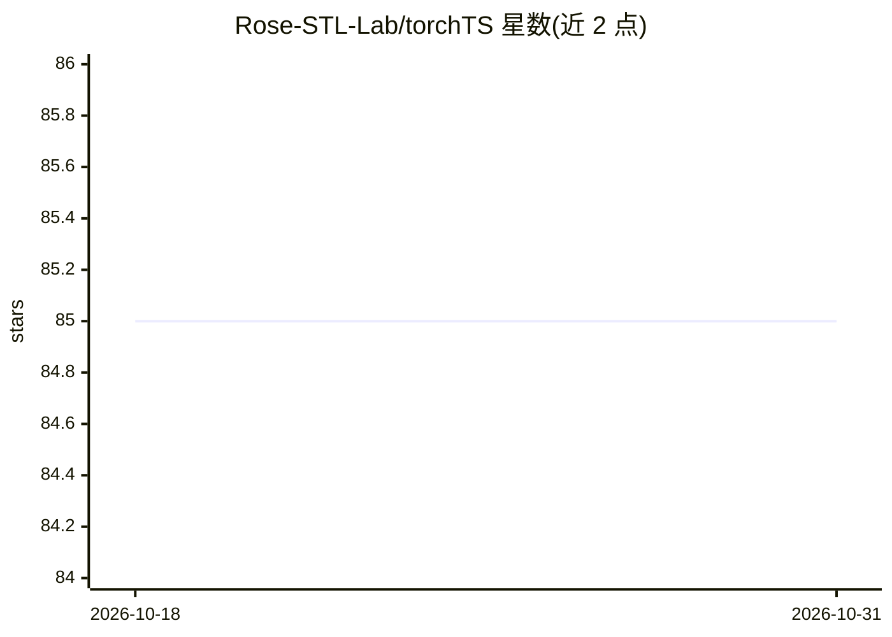

# Rose-STL-Lab/torchTS

⭐ 85 · Python · MIT · 推送 2026-10-05 · [GitHub](https://github.com/Rose-STL-Lab/torchTS) · [官网](https://rose-stl-lab.github.io/torchTS/) · 组织维护

**基于 PyTorch 的时间序列预测深度学习库，面向科研社区**

TorchTS 是基于 PyTorch 与 PyTorch Lightning 构建的时间序列建模库，目标是为公共卫生、金融、工程等领域的大规模感知数据提供深度学习预测工具。依赖 PyTorch、PyTorch Lightning 与 SciPy，支持 Python 3.8+，通过 pip 与 conda-forge 安装。README 将自身定位区别于 statsmodels、sktime（传统统计方法）与 GluonTS（基于 MXNet）。项目声明处于活跃开发阶段，教程与引用论文标注为即将推出，MIT 许可。

## 筛选速览

| 维度 | 判定 | 备注 |
|---|---|---|
| AI 角色 | `ai-native` | 本体是模型或模型工具 |
| 许可风险 | `permissive` | MIT |
| 部署形态 | `library` | 以包/库形式分发 |
| 模型依赖 | — | README 未给出锁定关系 |
| 硬件要求 | — | 无带数字的原话,不猜 |
| 安装摩擦 | `medium` | 含编译或系统依赖之一 |
| 成熟度 | `idea` | |

## 能力要点

- 基于 PyTorch / PyTorch Lightning 的时间序列建模框架
- 支持 pip 与 conda-forge 两种安装方式
- 支持自定义 PyTorch 安装（CUDA 版本 / 仅 CPU）

## 适用场景

- 科研人员进行时间序列预测的深度学习建模
- 金融、公共卫生、工程领域的时间序列分析
- 需要 PyTorch 生态内时序预测工具的开发者

## 场景标签

 · 领域:机器学习/时间序列预测

## 证据(README 行号)

> L13: TorchTS is a PyTorch-based library for time series data.
> L19: Time series data modeling has broad significance in public health, finance and engineering. Traditional time series

## 星数曲线

2026-10-18 85 → 2026-10-31 85（+0）

---
*卡片 v1 · prompt 1.4 · 生成 2026-10-24 · 置信度 high · 依据 README sha `31b687fe0580` · [字段定义](../../DATASET.md)*
