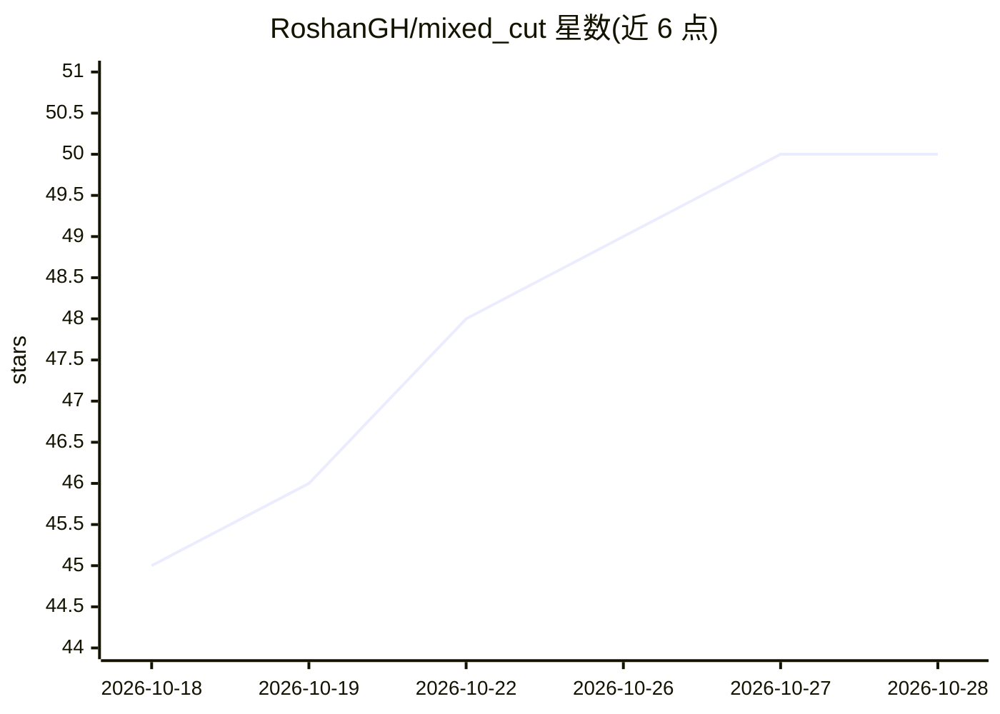

# RoshanGH/mixed_cut

⭐ 50 · Swift · MIT · 推送 2026-10-26 · [GitHub](https://github.com/RoshanGH/mixed_cut) · [官网](https://github.com/RoshanGH/mixed_cut/releases) · 个人维护 · 中文 README

**给广告投放团队的 macOS 混剪工具：AI 切分镜批量出广告**

面向广告投放团队的 macOS 原生桌面应用（SwiftUI + SwiftData）：导入广告素材后，本地 FFmpeg/Whisper 提取信号，云端 AI 做语义决策，自动切分为 11 类语义分镜，再按 AI 策略排列组合批量导出差异化广告。支持 AI 改写口播、克隆原视频说话人音色（千问 qwen-vc + 内置 demucs）、提示词替换分镜画面、烧录字幕。FFmpeg/Whisper/demucs 全部内置，视频与 API Key 本地处理，不向 AI 上传视频。需 macOS 14+，配音与画面替换依赖千问 DashScope 额度。

## 筛选速览

| 维度 | 判定 | 备注 |
|---|---|---|
| AI 角色 | `ai-native` | 本体是模型或模型工具 |
| 许可风险 | `permissive` | MIT |
| 部署形态 | `desktop` | 安装包/桌面程序 |
| 模型依赖 | locked-api |  |
| 硬件要求 | — | 无带数字的原话,不猜 |
| 安装摩擦 | `medium` | 含编译或系统依赖之一 |
| 成熟度 | — | 结构信号不足 |

## 能力要点

- 本地信号提取 + 云端 AI 语义决策，11 种语义分镜类型
- AI 配音：改写台词 + demucs 人声分离 + 原声音色克隆 + 保留 BGM
- 分镜头提示词画面替换，就地可恢复、零帧漂移
- FFmpeg/Whisper/demucs 内置零依赖，VideoToolbox 硬件加速导出

## 适用场景

- 批量生成多条差异化投放素材
- 替换广告口播配音并克隆原声
- 按提示词替换单个镜头画面（换背景/换主体/换颜色）

## 场景标签

`图像视频处理` `语音合成` · 领域:内容生成

## 证据(README 行号)

> L29: **MixCut 是一款面向广告投放团队的 macOS 桌面应用。** 你把广告素材视频导进来，它用本地信号提取 + 云端 AI 语义决策，把视频拆成一个个带类型标注的分镜，再帮你：
> L31: - 🎬 **智能混剪** —— AI 出策略 → 按策略排列分镜组合 → 一键批量导出多条差异化广告
> L121: MixCut 是纯 **SwiftUI + SwiftData** 原生应用，无第三方 SPM 依赖。设计上把「精确信号提取」和「语义决策」分开——所有视觉/音频信号由本地 FFmpeg / Whisper 精确提取成结构化数据

## 星数曲线

2026-10-18 45 → 2026-10-28 50（+5）

---
*卡片 v1 · prompt 1.4 · 生成 2026-10-25 · 置信度 high · 依据 README sha `14dbb67979fd` · [字段定义](../../DATASET.md)*
