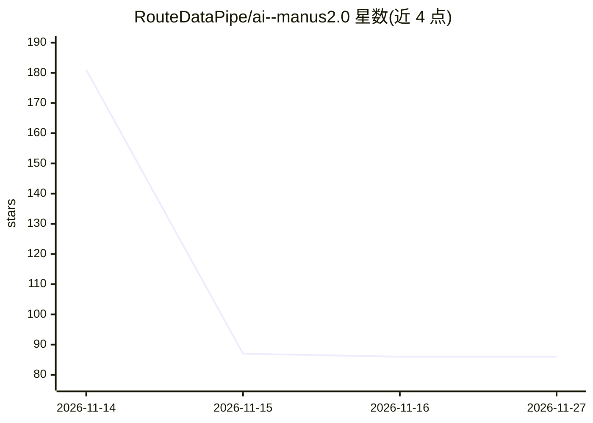

# RouteDataPipe/ai--manus2.0

⭐ 86 · Apache-2.0 · 推送 2026-11-15 · [GitHub](https://github.com/RouteDataPipe/ai--manus2.0) · 个人维护

**面向日常任务的自主 AI Agent：自动执行代码与控制浏览器**

Manus 是一个自主 AI agent，定位为在沙盒环境中运行多种工具与操作的通用 agent 系统。README 描述其可自行编写并执行脚本、控制浏览器（导航页面、填写表单、采集信息）、执行多步骤日常任务，脚本与浏览器动作可在同一流程中衔接。面向家庭、学习与轻量工作场景的用户，强调无需开发者背景。README 为营销式介绍，未给出具体的安装命令、依赖或接入方式，仅在 Getting Started 部分列出配置与测试的通用步骤，并列出 CPU/RAM/存储等兼容性建议。

## 筛选速览

| 维度 | 判定 | 备注 |
|---|---|---|
| AI 角色 | `ai-native` | 本体是模型或模型工具 |
| 许可风险 | `permissive` | Apache-2.0 |
| 部署形态 | `None` |  |
| 模型依赖 | — | README 未给出锁定关系 |
| 硬件要求 | — | 无带数字的原话,不猜 |
| 安装摩擦 | `low` | 无编译、无系统依赖或容器化 |
| 成熟度 | — | 结构信号不足 |

## 能力要点

- 自主代码执行：agent 自行编写并运行脚本完成任务
- 浏览器控制：导航网页、填写表单、采集信息
- 代码与浏览器动作在同一工作流中衔接，支持多步骤任务

## 适用场景

- 让学生整理研究笔记、运行小脚本
- 远程工作者从多个网页收集数据并汇总
- 把重复性的小型日常任务委托给后台 agent 处理

## 场景标签

`工作流自动化` `浏览器自动化` `编码 Agent` · 领域:效率与自动化

## 证据(README 行号)

> L10: - **Autonomous Code Execution:** Manus AI agent runs code on its own to complete tasks, so you can focus on decisio
> L18: Manus is an autonomous AI agent designed to run code and control a browser on your behalf. Instead of acting like a

## 星数曲线

2026-11-14 181 → 2026-11-27 86（-95）

---
*卡片 v1 · prompt 1.4 · 生成 2026-11-17 · 置信度 low · 依据 README sha `637da4fbcded` · [字段定义](../../DATASET.md)*
