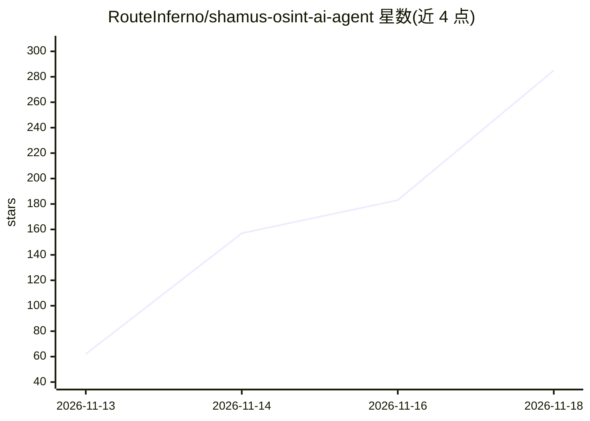

# RouteInferno/shamus-osint-ai-agent

⭐ 285 · JavaScript · MIT · 推送 2026-11-13 · [GitHub](https://github.com/RouteInferno/shamus-osint-ai-agent) · [官网](https://awesomeosint.tools/shamus/) · 个人维护

**终端内的 OSINT AI agent：自动选工具执行并撰写调查档案**

运行于 PowerShell 终端的命令行 OSINT AI agent：一条命令下达后，agent 自行制定计划，从内置的 12 个工具（如 whois、dns、archive）中选取并调用，读取每个工具输出后自行决定下一步，扩大搜索范围前会以 (Y/n) 形式向用户确认，最终写出调查案卷文件。定位为可管道化、可脚本化、可定时调度的 agent 而非固定脚本。提供 Windows 版下载，当前版本 v1.4.0。README 未给出具体的模型接入与配置细节。

## 筛选速览

| 维度 | 判定 | 备注 |
|---|---|---|
| AI 角色 | `ai-native` | 本体是模型或模型工具 |
| 许可风险 | `permissive` | MIT |
| 部署形态 | `None` |  |
| 模型依赖 | — | README 未给出锁定关系 |
| 硬件要求 | — | 无带数字的原话,不猜 |
| 安装摩擦 | `low` | 无编译、无系统依赖或容器化 |
| 成熟度 | — | 结构信号不足 |

## 能力要点

- agent 自主规划并顺序调用 12 个内置工具（whois/dns/archive 等）
- 每步读取工具输出后自行决定下一步，扩大搜索前询问用户
- 自动撰写调查案卷文件，支持管道、脚本与定时调度

## 适用场景

- 在终端用一条命令完成侦察与信息收集
- 定时或脚本化执行 OSINT 调查流程
- 将调查过程沉淀为案卷文件

## 场景标签

`网络安全` · 领域:学习与行业

## 证据(README 行号)

> L22: - **The main feature.** It is an agent, not a script: it reads each tool's output, decides the next step itself, an
> L4:  An OSINT agent that lives in your terminal. One command. It picks the tools, runs them, and writes the case file.

## 星数曲线

2026-11-13 62 → 2026-11-18 285（+223）

---
*卡片 v1 · prompt 1.4 · 生成 2026-11-17 · 置信度 mid · 依据 README sha `42232818effc` · [字段定义](../../DATASET.md)*
