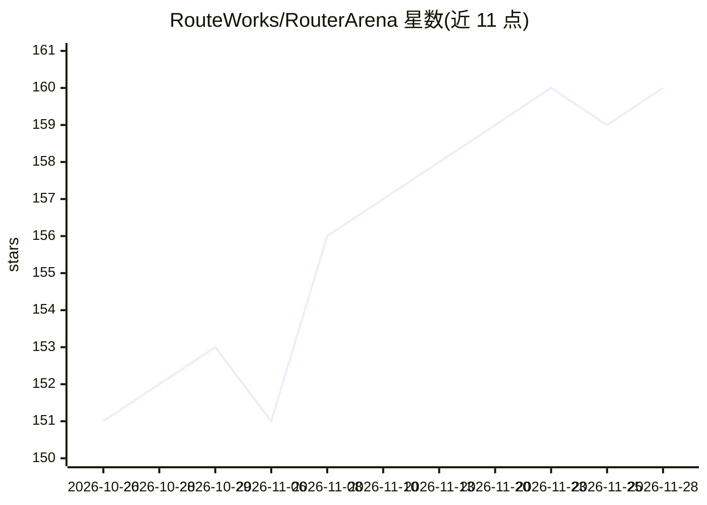

# RouteWorks/RouterArena

⭐ 160 · Python · Apache-2.0 · 推送 2026-11-16 · [GitHub](https://github.com/RouteWorks/RouterArena) · [官网](https://routeworks.github.io/) · 组织维护

**LLM 路由器的开源评测平台与实时排行榜**

RouterArena 面向 LLM 路由系统提供标准化评测：构建覆盖 9 个领域 44 个类别、含难度分级的数据集，定义准确率、成本、最优性、鲁棒性、延迟五项指标，并提供自动化评测流程——用户继承 BaseRouter 实现路由类、生成预测文件、运行推理与评测脚本，结果提交至实时排行榜。评测仅限评估用途，禁止用其数据训练或拟合路由器。通过 uv 安装，数据集从 Hugging Face 下载，支持商业与开源路由器接入。

## 筛选速览

| 维度 | 判定 | 备注 |
|---|---|---|
| AI 角色 | `ai-ecosystem` | LLM/agent 周边工具 |
| 许可风险 | `permissive` | Apache-2.0 |
| 部署形态 | `library` | 以包/库形式分发 |
| 模型依赖 | — | README 未给出锁定关系 |
| 硬件要求 | — | 无带数字的原话,不猜 |
| 安装摩擦 | `low` | 无编译、无系统依赖或容器化 |
| 成熟度 | — | 结构信号不足 |

## 能力要点

- 9 领域 44 类别、含难度分级的评测数据集
- 五项指标：准确率、成本、最优性、鲁棒性、延迟
- 自动化评测框架与实时排行榜
- 反作弊规则：禁止用评测数据训练或拟合路由器

## 适用场景

- 为自研 LLM 路由器获取标准化基准分数并提交排行榜
- 对比开源与商业路由器在准确率与成本上的权衡表现
- 对路由器做鲁棒性评测

## 场景标签

`模型评测` · 领域:评测与运维

## 证据(README 行号)

> L11: **RouterArena** is an open evaluation platform and leaderboard for **LLM routers**—systems that automatically selec
> L17: - ⚙️ **Automated Evaluation**: An automated evaluation framework to simplify the evaluation process for open-source
> L20: *We aim for RouterArena to serve as a foundation for the community to evaluate, understand, and advance LLM routing

## 星数曲线

2026-10-26 151 → 2026-11-28 160（+9）

---
*卡片 v1 · prompt 1.4 · 生成 2026-11-28 · 置信度 mid · 依据 README sha `e7fd4e224ff3` · [字段定义](../../DATASET.md)*
