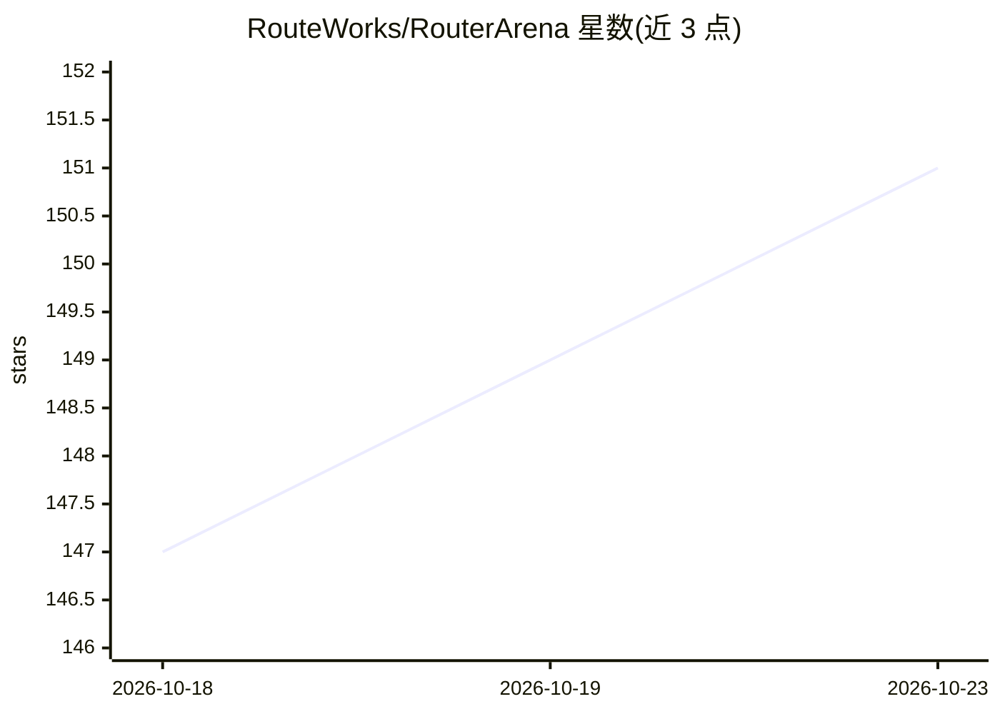

# RouteWorks/RouterArena

⭐ 151 · Python · Apache-2.0 · 推送 2026-09-29 · [GitHub](https://github.com/RouteWorks/RouterArena) · [官网](https://routeworks.github.io/) · 组织维护

**面向 LLM 路由器的开放评测平台与在线排行榜**

RouterArena 提供针对 LLM 路由器（为查询自动选模型的系统）的标准化评测：数据集覆盖 9 领域 44 类别、三档难度，指标含准确率、成本、最优性、鲁棒性、延迟五项。用户继承 BaseRouter 类实现 _get_prediction() 生成路由决策文件，经 LLM 推理与评测脚本后可通过 PR 提交至自动评测流程并上榜。明确声明为仅限评测的数据集，禁止用于训练或调优路由器组件。联系方式为 Rice 大学邮箱，附 arXiv 论文与 Hugging Face 数据集。

## 筛选速览

| 维度 | 判定 | 备注 |
|---|---|---|
| AI 角色 | `ai-ecosystem` | LLM/agent 周边工具 |
| 许可风险 | `permissive` | Apache-2.0 |
| 部署形态 | `library` | 以包/库形式分发 |
| 模型依赖 | — | README 未给出锁定关系 |
| 硬件要求 | — | 无带数字的原话,不猜 |
| 安装摩擦 | `low` | 无编译、无系统依赖或容器化 |
| 成熟度 | — | 结构信号不足 |

## 能力要点

- 9 领域 44 类别、三档难度的评测数据集（sub_10/full/robustness 三个切分）
- 五项路由关键指标：准确率、成本、最优选择、鲁棒性、延迟
- PR 提交触发 /evaluate 自动评测工作流，结果更新在线排行榜
- 继承 BaseRouter 自定义路由器类即可接入评测流程

## 适用场景

- 评测自研 LLM 路由器在准确率与成本上的表现
- 将路由器提交到公开排行榜与其他方案对比
- 用鲁棒性数据集测试路由决策对提示扰动的稳定性

## 场景标签

`模型评测` · 领域:评测与运维

## 证据(README 行号)

> L11: **RouterArena** is an open evaluation platform and leaderboard for **LLM routers**—systems that automatically selec
> L13: RouterArena bridges this gap by providing an open evaluation platform and benchmarking framework for both open-sour
> L17: - ⚙️ **Automated Evaluation**: An automated evaluation framework to simplify the evaluation process for open-source

## 星数曲线

2026-10-18 147 → 2026-10-23 151（+4）

---
*卡片 v1 · prompt 1.4 · 生成 2026-10-23 · 置信度 mid · 依据 README sha `86f8ae471f0c` · [字段定义](../../DATASET.md)*
