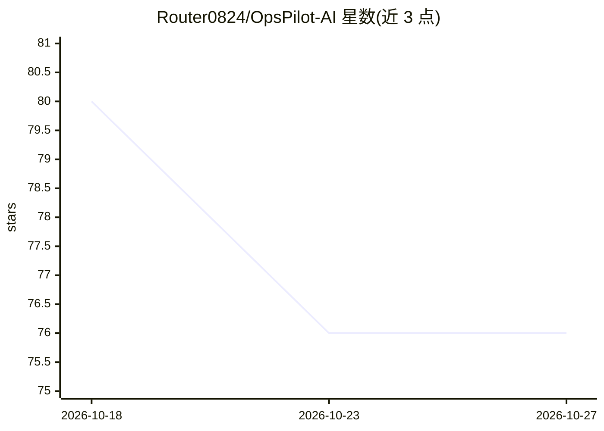

# Router0824/OpsPilot-AI

⭐ 76 · TypeScript · MIT · 推送 2026-10-21 · [GitHub](https://github.com/Router0824/OpsPilot-AI) · 个人维护 · 中文 README

**面向团队的开源 AI 运营工作台：会议/文档转决策、任务与组织记忆**

全栈 AI Operations 产品（Next.js 16 + React 19 前端、FastAPI 后端），将知识检索、会议跟进、任务协调、决策沉淀、风险识别、工作流自动化与运营分析整合到同一工作区。所有写入型建议需人工审核后进入正式数据。默认确定性演示模式无需 API Key，实时模式支持 OpenAI、Azure OpenAI 与 DeepSeek，输出经 Pydantic Schema 校验。默认 SQLite，可切换 PostgreSQL；提供 git clone 源码安装与 Docker Compose 部署。

## 筛选速览

| 维度 | 判定 | 备注 |
|---|---|---|
| AI 角色 | `ai-native` | 本体是模型或模型工具 |
| 许可风险 | `permissive` | MIT |
| 部署形态 | `self-host` | docker 或自建部署 |
| 模型依赖 | locked-api |  |
| 硬件要求 | — | 无带数字的原话,不猜 |
| 安装摩擦 | `low` | 无编译、无系统依赖或容器化 |
| 成熟度 | — | 结构信号不足 |

## 能力要点

- 会议记录提取摘要、决策、行动项、风险，写入前人工审核
- 确定性本地混合检索（特征哈希余弦+关键词+短语信号），可替换 Embedding/pgvector
- 演示模式无需 API Key 即可体验完整流程
- 中英双语界面与活动审计/运营分析

## 适用场景

- 团队把会议纪要与项目文档沉淀为决策记忆与可跟进任务
- 运营助理基于工作区实时状态回答进度、阻塞与逾期问题
- 将会议跟进、周报、风险检测封装为可审核的自动化工作流

## 场景标签

`工作流自动化` `知识库管理` `文档问答` · 领域:效率与自动化

## 证据(README 行号)

> L12: OpsPilot AI 是一个面向真实团队协作场景的全栈 AI Operations 产品。它将知识检索、会议跟进、任务协调、决策沉淀、风险识别、流程审核和运营分析整合到同一个可追踪的工作区中。
> L14: 项目默认使用确定性的演示模式，无需 API Key 即可体验完整流程；实时模式支持 OpenAI、Azure OpenAI 和 DeepSeek，并通过统一的结构化输出层保证数据质量。
> L52: - **会议智能**：从会议记录中提取可审核的摘要、决策、行动项、负责人、截止日期、风险和待确认问题。

## 星数曲线

2026-10-18 80 → 2026-10-27 76（-4）

---
*卡片 v1 · prompt 1.4 · 生成 2026-10-24 · 置信度 high · 依据 README sha `602f3a542f3c` · [字段定义](../../DATASET.md)*
