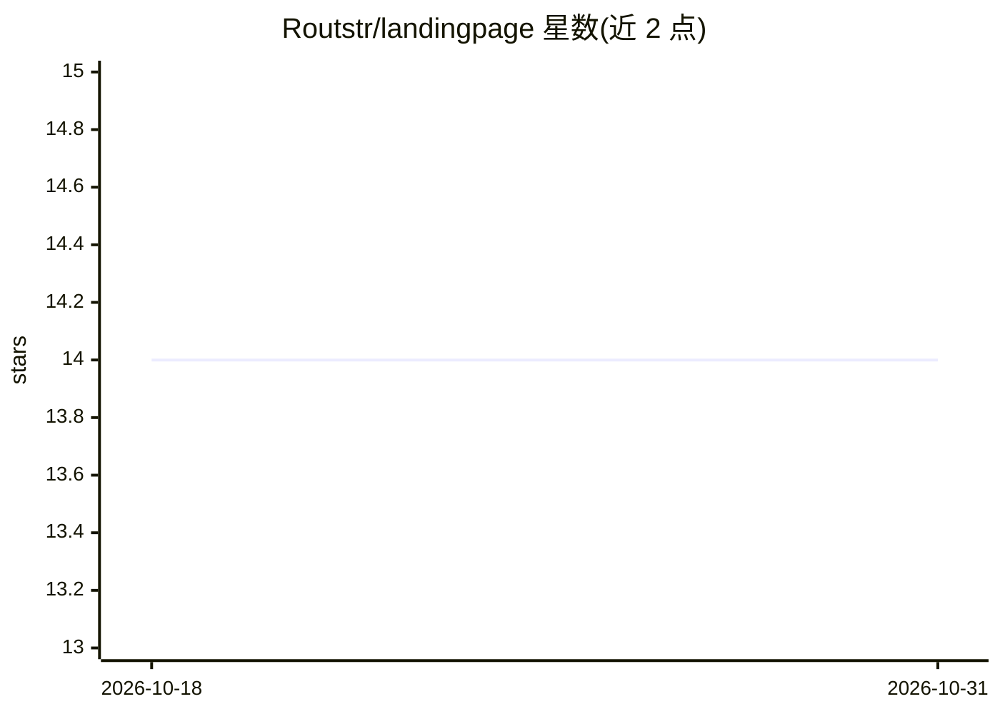

# Routstr/landingpage

⭐ 14 · TypeScript · GPL-3.0 · 推送 2026-10-29 · [GitHub](https://github.com/Routstr/landingpage) · [官网](https://routstr.com) · 组织维护

**去中心化 LLM 路由市场的 Next.js 前端界面**

Routstr 是基于 Nostr 与 Bitcoin 的去中心化 LLM 路由市场，本仓库为其 Next.js 15（App Router）+ React 19 + TypeScript 前端：提供浏览提供商/模型列表与详情、通过 OpenAI 兼容 API 与模型交互、处理 Cashu/Lightning 支付流程的 UI。使用 nostr-tools（NIP-07 签名、中继）与 cashu-ts，配置为静态导出（out/）可部署到 Cloudflare Pages；构建动态详情页需构建环境可访问 provider/model 数据源。

## 筛选速览

| 维度 | 判定 | 备注 |
|---|---|---|
| AI 角色 | `ai-ecosystem` | LLM/agent 周边工具 |
| 许可风险 | `viral` | GPL-3.0 |
| 部署形态 | `library` | 以包/库形式分发 |
| 模型依赖 | — | README 未给出锁定关系 |
| 硬件要求 | — | 无带数字的原话,不猜 |
| 安装摩擦 | `low` | 无编译、无系统依赖或容器化 |
| 成熟度 | — | 结构信号不足 |

## 能力要点

- 浏览提供商/模型的列表与详情页面
- OpenAI 兼容 API 的模型交互界面
- Cashu/Lightning 支付流程处理
- 静态导出部署（Cloudflare Pages 配置说明）

## 适用场景

- 本地运行或部署 Routstr 市场的 Web 前端
- 浏览去中心化 LLM 市场中的提供商与模型
- 通过界面完成 Cashu/Lightning 支付后调用模型

## 场景标签

 · 领域:LLM 基础设施/去中心化市场

## 证据(README 行号)

> L5: Routstr is a decentralized LLM routing marketplace powered by Nostr and Bitcoin. This repository contains the Next.j

## 星数曲线

2026-10-18 14 → 2026-10-31 14（+0）

---
*卡片 v1 · prompt 1.4 · 生成 2026-10-31 · 置信度 high · 依据 README sha `755e9a472f5a` · [字段定义](../../DATASET.md)*
