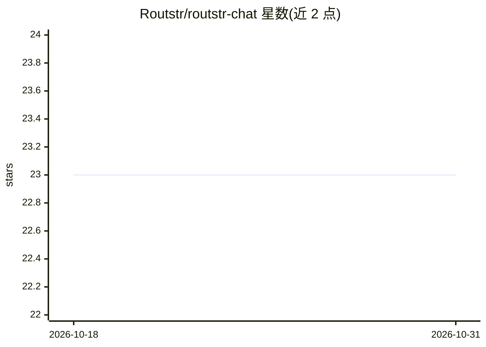

# Routstr/routstr-chat

⭐ 23 · TypeScript · 推送 2026-10-29 · [GitHub](https://github.com/Routstr/routstr-chat) · [官网](https://chat.routstr.com) · 组织维护

**Routstr 协议的本地聊天前端，支持闪电网络支付**

基于 Next.js 16 / React 19 的纯客户端聊天界面，实现 routstr 协议：提供对话历史、模型选择与可配置 providers，集成 Cashu 闪电网络钱包（充值、余额、发票历史）与 Nostr 中继连接，状态用 Zustand 与 localStorage 持久化。支持静态导出部署到任意静态托管、Docker（nginx）或传统 Node 服务器（Node.js 18+）。开发模式内置 MSW API 模拟，可测试 413 等错误场景。

## 筛选速览

| 维度 | 判定 | 备注 |
|---|---|---|
| AI 角色 | `ai-ecosystem` | LLM/agent 周边工具 |
| 许可风险 | `none` | — |
| 部署形态 | `library` | 以包/库形式分发 |
| 模型依赖 | — | README 未给出锁定关系 |
| 硬件要求 | — | 无带数字的原话,不猜 |
| 安装摩擦 | `low` | 无编译、无系统依赖或容器化 |
| 成熟度 | — | 结构信号不足 |

## 能力要点

- 聊天 UI 支持对话历史与模型/providers 配置
- Cashu 闪电网络钱包集成（充值、余额、发票历史）
- Nostr 支持与中继连接
- 纯客户端静态导出，无需服务器即可部署

## 适用场景

- 通过闪电网络按使用付费地与模型对话
- 在任意静态托管上自托管聊天前端
- 结合 regtest 环境测试钱包与发票流程

## 场景标签

`聊天机器人` · 领域:对话与助手

## 证据(README 行号)

> L7: - **Chat UI** with conversation history and model selection
> L10: - **Configurable models** and providers

## 星数曲线

2026-10-18 23 → 2026-10-31 23（+0）

---
*卡片 v1 · prompt 1.4 · 生成 2026-10-27 · 置信度 mid · 依据 README sha `a01960459207` · [字段定义](../../DATASET.md)*
