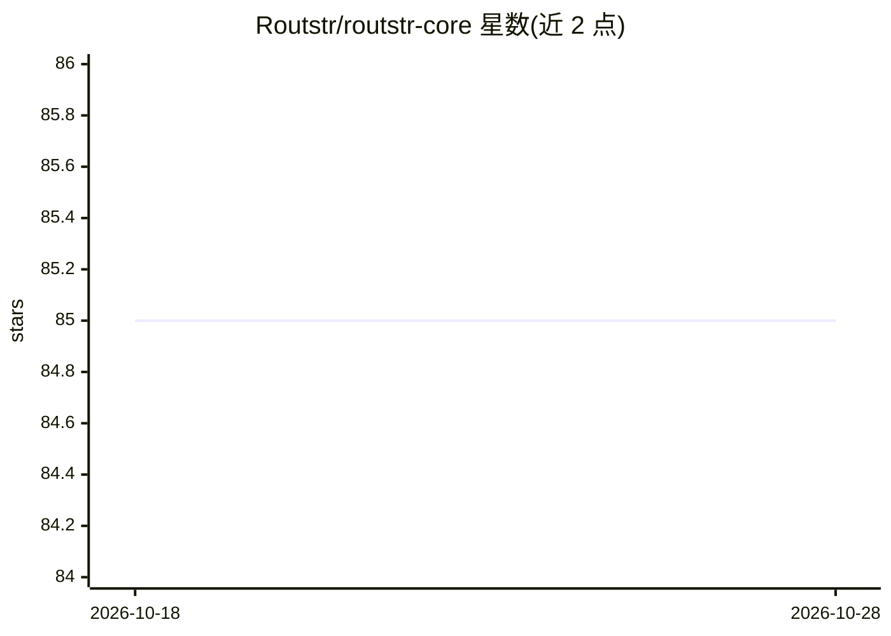

# Routstr/routstr-core

⭐ 85 · Python · GPL-3.0 · 推送 2026-10-27 · [GitHub](https://github.com/Routstr/routstr-core) · [官网](http://docs.routstr.com/) · 组织维护

**去中心化 AI 推理付费代理协议核心：Nostr 发现 + Cashu 微支付**

Routstr Core 是一个基于 FastAPI 的反向代理，部署在 OpenAI 兼容 API 之前，处理按请求计费。协议层结合 Nostr 做节点发现、Cashu 做比特币隐私微支付，用户以 OpenAI SDK 或 cURL 指向 Routstr 节点并用 Cashu token 支付。面向运营推理服务节点的提供者与按请求付费的开发者用户。提供 Docker Compose 引导式部署（含私有模式、Tor 公开栈）、CLI 管理工具与本地开发流程。

## 筛选速览

| 维度 | 判定 | 备注 |
|---|---|---|
| AI 角色 | `ai-ecosystem` | LLM/agent 周边工具 |
| 许可风险 | `viral` | GPL-3.0 |
| 部署形态 | `self-host` | docker 或自建部署 |
| 模型依赖 | — | README 未给出锁定关系 |
| 硬件要求 | — | 无带数字的原话,不猜 |
| 安装摩擦 | `low` | 无编译、无系统依赖或容器化 |
| 成熟度 | — | 结构信号不足 |

## 能力要点

- FastAPI 反向代理，接入 OpenAI 兼容 API 并按请求计费
- Nostr 节点发现与 Cashu 比特币隐私微支付
- compose.node.yml 私有部署选项与公网/Tor 双栈
- 生成全节点管理权限的 CLI token（可撤销）

## 适用场景

- 运营一个按请求收费的 AI 推理提供者节点
- 用 OpenAI SDK/cURL 指向 Routstr 节点并以 Cashu token 付费
- 在 Nostr 网络发布并发现推理服务节点

## 场景标签

`模型网关` · 领域:Agent 开发

## 证据(README 行号)

> L8: Routstr is a decentralized protocol for permissionless, private, and censorship-resistant AI inference. It combines 
> L10: This repo contains Routstr Core: a FastAPI-based reverse proxy that sits in front of OpenAI-compatible APIs and han
> L21: If you are a user/developer, you just point an OpenAI-compatible SDK at a Routstr node and pay with a Cashu token.

## 星数曲线

2026-10-18 85 → 2026-10-28 85（+0）

---
*卡片 v1 · prompt 1.4 · 生成 2026-10-24 · 置信度 high · 依据 README sha `677269721564` · [字段定义](../../DATASET.md)*
