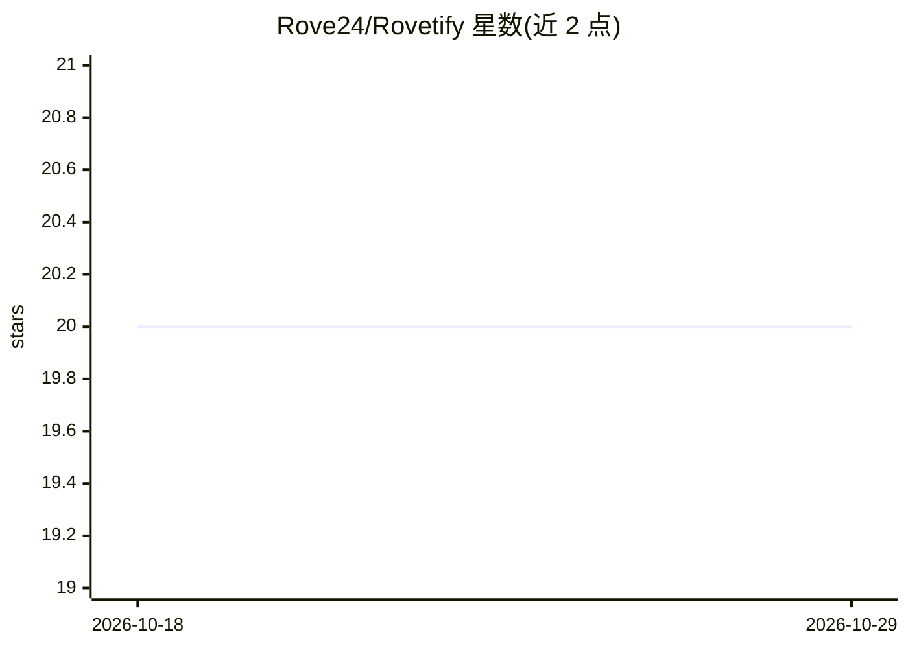

# Rove24/Rovetify

⭐ 20 · JavaScript · MIT · 推送 2026-09-03 · [GitHub](https://github.com/Rove24/Rovetify) · [官网](https://greasyfork.org/scripts/570598-rovetify-youtube-summary-with-gemini) · 个人维护 · 中文 README

**用 Gemini 总结 YouTube 视频并支持双语字幕的浏览器脚本**

基于 Tampermonkey 的用户脚本，嵌入 YouTube 原生界面，调用 Google Gemini API 实现视频结构化总结、针对视频内容的实时问答、拦截原生字幕流生成双语同步字幕，并支持字幕文本导出。用户需自行配置 Gemini API key，通过 GreasyFork 安装。界面适配 YouTube 深浅色模式。以 MIT 许可发布，提供赞助渠道。

## 筛选速览

| 维度 | 判定 | 备注 |
|---|---|---|
| AI 角色 | `ai-native` | 本体是模型或模型工具 |
| 许可风险 | `permissive` | MIT |
| 部署形态 | `None` |  |
| 模型依赖 | — | README 未给出锁定关系 |
| 硬件要求 | — | 无带数字的原话,不猜 |
| 安装摩擦 | `low` | 无编译、无系统依赖或容器化 |
| 成熟度 | — | 结构信号不足 |

## 能力要点

- 一键生成视频结构化总结（Gemini 模型）
- 针对视频内容实时向 AI 提问
- 拦截原生字幕流实现双语同步对照并支持导出
- 适配 YouTube 深浅色模式的原生风格 UI

## 适用场景

- 观看 YouTube 视频时快速获取内容总结
- 边看边问，向 AI 询问视频中的细节
- 生成双语字幕对照并导出字幕文本

## 场景标签

`多模态` · 领域:感知与多模态

## 证据(README 行号)

> L3: **Rovetify** is a clean and powerful YouTube video assistant. It leverages Google Gemini AI to provide structured su
> L10:  Based on the latest Gemini models, extract core video insights with a single click.

## 星数曲线

2026-10-18 20 → 2026-10-29 20（+0）

---
*卡片 v1 · prompt 1.4 · 生成 2026-10-28 · 置信度 high · 依据 README sha `a5b41fd31c19` · [字段定义](../../DATASET.md)*
