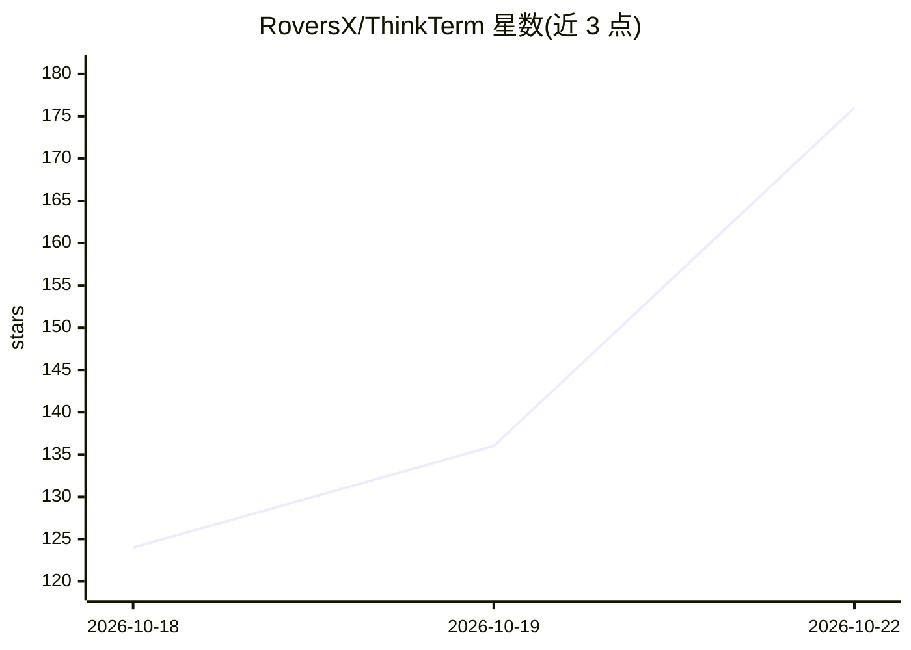

# RoversX/ThinkTerm

⭐ 176 · Rust · GPL-3.0 · 推送 2026-10-21 · [GitHub](https://github.com/RoversX/ThinkTerm) · [官网](https://closex.org/thinkterm/) · 个人维护

**内置多路复用器的 Rust 终端，跨机运行 shell 与编码代理**

基于 WezTerm、用 Rust 编写的开源终端，内置 mux server 持有会话与分屏：客户端（桌面、TUI、浏览器，移动端开发中）断开后进程继续运行，可从其他设备重连。支持跨机器连接本地与远程会话（SSH/Mosh）、ThinkTerm Connect 汇聚远程工作区、内置 Tailscale、SFTP 文件访问、Obsidian 兼容笔记与 Rust 插件 SDK。面向运行多个编码代理的开发者，提供 Agents 面板展示代理状态，并通过 CLI 命令让代理操作终端面板。会话持久性依赖 mux server 存活，服务器重启后不恢复进程。

## 筛选速览

| 维度 | 判定 | 备注 |
|---|---|---|
| AI 角色 | `ai-enhanced` | 去掉 AI 部分产品仍成立 |
| 许可风险 | `viral` | GPL-3.0 |
| 部署形态 | `library` | 以包/库形式分发 |
| 模型依赖 | — | README 未给出锁定关系 |
| 硬件要求 | — | 无带数字的原话,不猜 |
| 安装摩擦 | `medium` | 含编译或系统依赖之一 |
| 成熟度 | `idea` | |

## 能力要点

- mux server 持有会话，客户端断开后 shell 与代理任务继续运行
- 桌面/TUI/浏览器多客户端接入同一会话，跨机器切换工作区
- CLI 暴露面板给自动化（send-text/get-text/wait 等），供代理操作终端
- Agents 面板汇总识别到的编码代理及其状态（可在设置中关闭）

## 适用场景

- 在多台机器上运行多个 AI 编码代理并集中监控其状态
- 从桌面、浏览器或 TUI 随时接续同一批终端会话
- 通过远程 mux 会话在本地界面中操作远程服务器工作区

## 场景标签

 · 领域:开发者工具/终端

## 证据(README 行号)

> L22: ThinkTerm is an open-source **terminal with a built-in multiplexer, written in Rust**, built on WezTerm. Its mux se
> L72: - **Agent status.** The Agents panel brings recognized coding agents into one list with their work status and proje
> L82: The CLI also exposes panes to automation: `thinkterm cli send-text` sends input, `send-key` presses keys, `get-text

## 星数曲线

2026-10-18 124 → 2026-10-22 176（+52）

---
*卡片 v1 · prompt 1.4 · 生成 2026-10-22 · 置信度 mid · 依据 README sha `3a447b075d86` · [字段定义](../../DATASET.md)*
