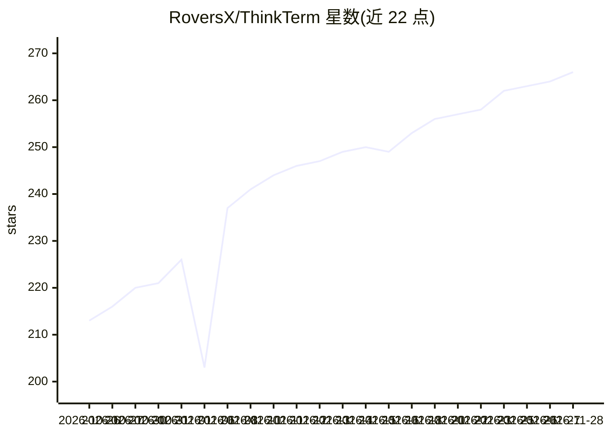

# RoversX/ThinkTerm

⭐ 266 · Rust · GPL-3.0 · 推送 2026-11-27 · [GitHub](https://github.com/RoversX/ThinkTerm) · [官网](https://closex.org/thinkterm/) · 个人维护 · 中文 README

**跨机管理终端会话与 AI agent 的多路复用终端**

基于 WezTerm 构建的终端多路复用器：mux 服务器持有会话、标签页与分屏，客户端断开后会话继续运行，可从桌面、TUI、浏览器和移动端重新接入；多台机器的远程工作区通过 ThinkTerm Connect 汇入同一侧边栏。终端核心以 Rust 编写，GPU 渲染，README 给出与 WezTerm、kitty、Ghostty 的吞吐基准数据。AI 相关功能为 Agents 面板：将识别到的编码 agent 集中列出并显示工作状态，可在设置中关闭。会话持久性依赖 mux 服务器与主机存活，服务器重启或主机重启后不恢复运行中的进程。

## 筛选速览

| 维度 | 判定 | 备注 |
|---|---|---|
| AI 角色 | `ai-enhanced` | 去掉 AI 部分产品仍成立 |
| 许可风险 | `viral` | GPL-3.0 |
| 部署形态 | `library` | 以包/库形式分发 |
| 模型依赖 | — | README 未给出锁定关系 |
| 硬件要求 | — | 无带数字的原话,不猜 |
| 安装摩擦 | `medium` | 含编译或系统依赖之一 |
| 成熟度 | — | 结构信号不足 |

## 能力要点

- mux 服务器持有会话，客户端断开后 shell、构建与 agent 任务继续运行
- 桌面、TUI、浏览器、iOS/Android 多客户端接入同一会话
- Agents 面板集中显示识别到的编码 agent 的工作状态
- 内置 Tailscale、SFTP 文件浏览、Obsidian 兼容 Markdown 笔记与 Rust 插件 SDK

## 适用场景

- 在多台机器上并行运行多个编码 agent 并统一查看状态
- SSH/Mosh 连接远程主机并保持会话不中断
- 从浏览器或手机接回桌面上的工作会话

## 场景标签

 · 领域:开发工具/终端

## 证据(README 行号)

> L109: A terminal multiplexer manages multiple terminal sessions and lets clients attach to them. In ThinkTerm, **the mux
> L143: - **Agent status.** The Agents panel brings recognized coding agents into one list with their work status and proj
> L103: Rust powers ThinkTerm's terminal core, mux server, desktop client, and TUI. The desktop renders through the GPU wi

## 星数曲线

2026-10-26 213 → 2026-11-28 266（+53）

---
*卡片 v1 · prompt 1.4 · 生成 2026-11-27 · 置信度 mid · 依据 README sha `f1ddd7e2db1f` · [字段定义](../../DATASET.md)*
