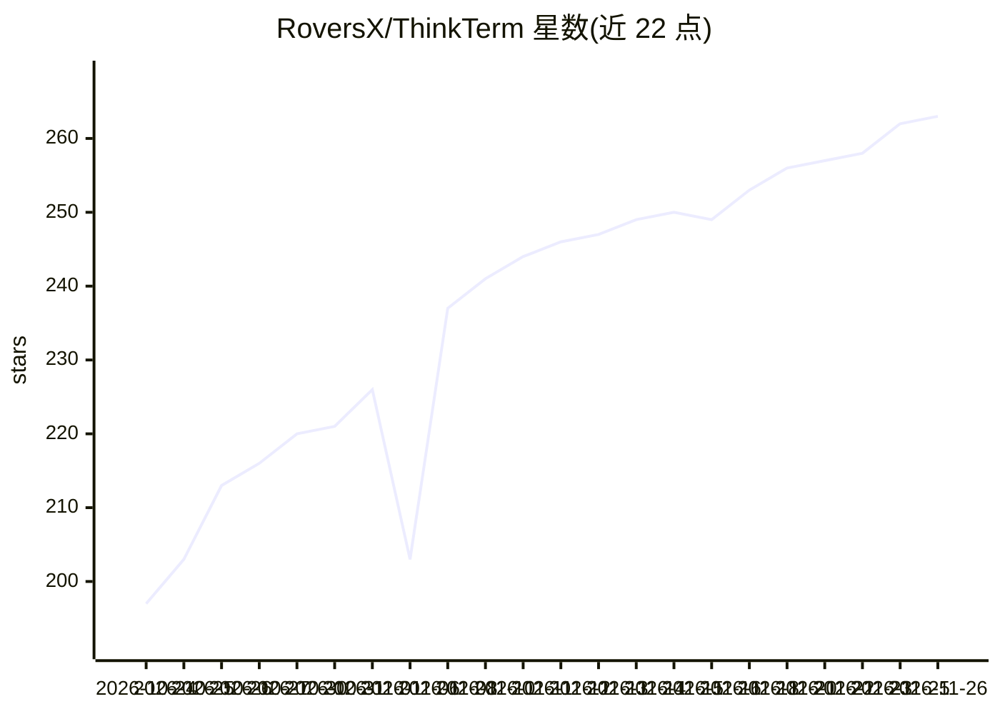

# RoversX/ThinkTerm

⭐ 263 · Rust · GPL-3.0 · 推送 2026-11-25 · [GitHub](https://github.com/RoversX/ThinkTerm) · [官网](https://closex.org/thinkterm/) · 个人维护 · 中文 README

**为多机终端与 AI agent 会话提供持久复用器的终端**

基于 WezTerm、用 Rust 编写的开源终端，核心是内建复用器（mux server）：会话、标签页与分屏由服务器持有，断开后继续运行，可从桌面、TUI、浏览器等多客户端重连。支持 Space/Project/Thread 工作区组织、SSH/Mosh 远程会话、内建 Tailscale、SFTP 文件浏览、Markdown 笔记、片段与 Rust 插件 SDK。Agents 面板将识别到的编码 agent 集中展示工作状态，可在设置中禁用。桌面版通过 GPU 渲染，无 Electron 与内嵌 WebView；会话持久性不覆盖服务器重启或主机断电。

## 筛选速览

| 维度 | 判定 | 备注 |
|---|---|---|
| AI 角色 | `ai-enhanced` | 去掉 AI 部分产品仍成立 |
| 许可风险 | `viral` | GPL-3.0 |
| 部署形态 | `library` | 以包/库形式分发 |
| 模型依赖 | — | README 未给出锁定关系 |
| 硬件要求 | — | 无带数字的原话,不猜 |
| 安装摩擦 | `medium` | 含编译或系统依赖之一 |
| 成熟度 | — | 结构信号不足 |

## 能力要点

- mux server 持有会话，断开客户端后 shell/构建/agent 任务继续运行
- 桌面、TUI、浏览器多客户端接入同一批共享会话
- Agents 面板集中显示识别到的编码 agent 的状态与项目上下文
- Rust + GPU 渲染，基于 WezTerm，无 Electron 或 WebView

## 适用场景

- 在多台机器上运行多个 coding agent 并统一查看各自状态
- SSH 断线后回到原来的远程会话继续任务
- 从浏览器或 TUI 接入家里/服务器上的工作区

## 场景标签

`编码 Agent` · 领域:编码与开发

## 证据(README 行号)

> L22: ThinkTerm is an open-source **terminal with a built-in multiplexer, written in Rust**, built on WezTerm. Its mux se
> L137: - **Agent status.** The Agents panel brings recognized coding agents into one list with their work status and proj

## 星数曲线

2026-10-24 197 → 2026-11-26 263（+66）

---
*卡片 v1 · prompt 1.4 · 生成 2026-11-25 · 置信度 mid · 依据 README sha `459941183db3` · [字段定义](../../DATASET.md)*
