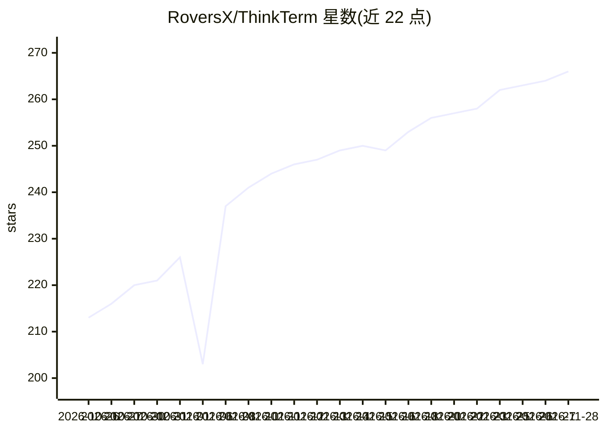

# RoversX/ThinkTerm

⭐ 266 · Rust · GPL-3.0 · 推送 2026-11-27 · [GitHub](https://github.com/RoversX/ThinkTerm) · [官网](https://closex.org/thinkterm/) · 个人维护 · 中文 README

**为多机终端与 AI agent 并行工作提供的 GPU 渲染终端多路复用器**

基于 WezTerm 构建的终端多路复用器：mux 服务器持有会话、标签页与分屏，客户端断开后会话继续运行，可从桌面、TUI、浏览器、iOS/Android 等多端接入同一会话；通过 ThinkTerm Connect 聚合多台机器的远程工作区，支持 SSH/Mosh、SFTP 文件浏览、Markdown 笔记与 Rust 插件 SDK。Agents 面板将识别到的编码 agent 汇总为状态列表，CLI 提供向面板发送输入/读取输出的自动化命令。会话持久性依赖 mux 服务器与主机可用，主机重启后不恢复运行中的进程。

## 筛选速览

| 维度 | 判定 | 备注 |
|---|---|---|
| AI 角色 | `ai-enhanced` | 去掉 AI 部分产品仍成立 |
| 许可风险 | `viral` | GPL-3.0 |
| 部署形态 | `library` | 以包/库形式分发 |
| 模型依赖 | — | README 未给出锁定关系 |
| 硬件要求 | — | 无带数字的原话,不猜 |
| 安装摩擦 | `medium` | 含编译或系统依赖之一 |
| 成熟度 | — | 结构信号不足 |

## 能力要点

- mux 服务器持有会话，多客户端（桌面/TUI/浏览器/移动端）可同时接入
- 跨机器远程工作区聚合，支持 SSH/Mosh 与 SFTP 文件传输
- Agents 面板汇总识别到的编码 agent 的工作状态与项目上下文
- Rust 实现，桌面端经 GPU 渲染，无 Electron 或内嵌 WebView

## 适用场景

- 在多台机器上并行运行多个 AI 编码 agent 并统一查看状态
- 断开连接后继续保留远程构建或 agent 任务会话
- 从浏览器或手机接入桌面上的同一批终端会话

## 场景标签

`编码 Agent` · 领域:编码与开发

## 证据(README 行号)

> L13: A superfast terminal multiplexer built on top of WezTerm.
> L145: - **Agent status.** The Agents panel brings recognized coding agents into one list with their work status and proj
> L103: Running several agents across different projects quickly turns a tab bar into a guessing game: which session is wo

## 星数曲线

2026-10-26 213 → 2026-11-28 266（+53）

---
*卡片 v1 · prompt 1.4 · 生成 2026-11-28 · 置信度 mid · 依据 README sha `496a3cef84c4` · [字段定义](../../DATASET.md)*
