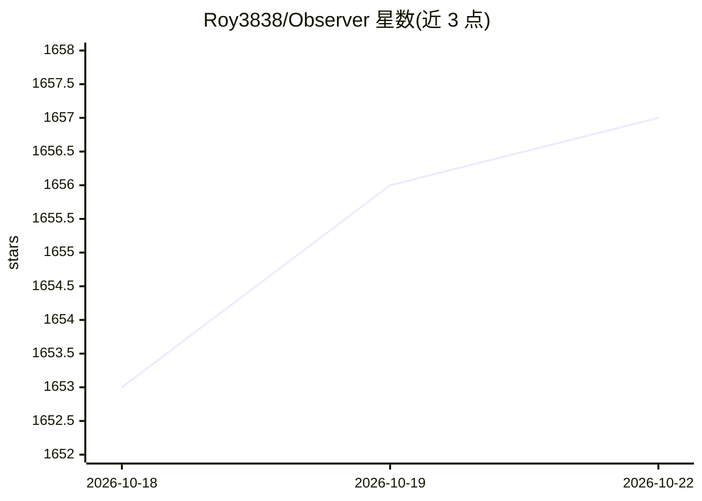

# Roy3838/Observer

⭐ 1,657 · TypeScript · AGPL-3.0 · 推送 2026-10-22 · [GitHub](https://github.com/Roy3838/Observer) · [官网](https://observer-ai.com/) · 个人维护

**本地模型驱动的屏幕监控 Agent 应用，按条件触发通知**

面向终端用户/开发者的桌面监控 Agent 平台：通过屏幕截图、摄像头、麦克风、OCR、音频转写等传感器采集输入，交给本地小模型（Transformers.js、内置 llama.cpp 的 GGUF 模型或任意 OpenAI 兼容端点如 Ollama/vLLM）按循环判断，命中条件后通过邮件、Telegram、WhatsApp、Discord、SMS 等工具发送通知或执行录制、记忆等操作。支持文本模型与按概率答题的 Decision Models，Agent 逻辑用浏览器沙箱中的 JavaScript 编写。提供 WebApp、桌面 App（含 CLI 二进制，可 cargo build 从源码构建）；Docker 与 Jupyter 方案已标记弃用。

## 筛选速览

| 维度 | 判定 | 备注 |
|---|---|---|
| AI 角色 | `ai-native` | 本体是模型或模型工具 |
| 许可风险 | `viral` | AGPL-3.0 |
| 部署形态 | `None` |  |
| 模型依赖 | local-ok | 支持本地模型 |
| 硬件要求 | — | 无带数字的原话,不猜 |
| 安装摩擦 | `low` | 无编译、无系统依赖或容器化 |
| 成熟度 | — | 结构信号不足 |

## 能力要点

- 屏幕/摄像头/麦克风/OCR/音频转写多传感器输入
- 本地推理：Transformers.js、内置 llama.cpp、任意 OpenAI 兼容端点
- Decision Models 按概率回答是/否/选择/评分类问题
- 邮件/Telegram/WhatsApp/Discord/SMS/电话等多渠道通知工具

## 适用场景

- 下载完成、渲染结束时自动收到消息通知
- 摄像头检测到人进入房间时收到告警
- 会议音频转写并记录内容

## 场景标签

`Agent 框架` · 领域:Agent 开发

## 证据(README 行号)

> L8: ### *_The Agent that monitors your screen, so you don't have to._*
> L10: Using local models, keeping your data **100% private and secure**.
> L43:  Local LLMs

## 星数曲线

2026-10-18 1,653 → 2026-10-22 1,657（+4）

---
*卡片 v1 · prompt 1.4 · 生成 2026-10-21 · 置信度 high · 依据 README sha `b5d392eb2a2a` · [字段定义](../../DATASET.md)*
