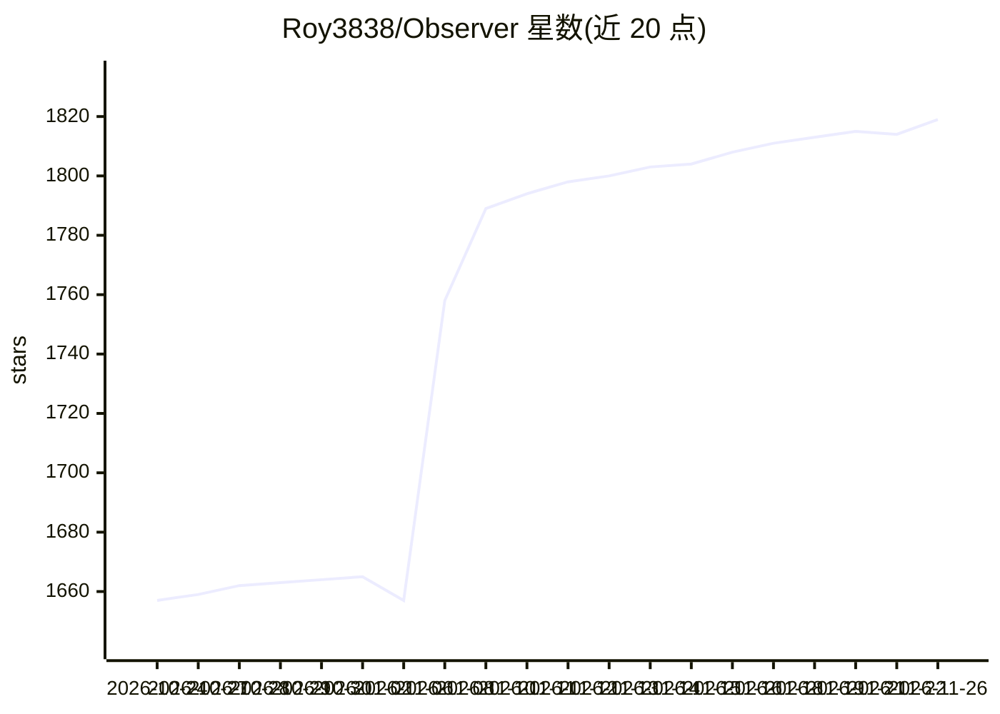

# Roy3838/Observer

⭐ 1,819 · TypeScript · AGPL-3.0 · 推送 2026-11-25 · [GitHub](https://github.com/Roy3838/Observer) · [官网](https://observer-ai.com/) · 个人维护

**本地运行的多 agent 屏幕监控编排器，事件触发通知**

一个部署微型 agent 的编排器：每个 micro-agent 以 Sensors → Model → Code 循环运行，读取屏幕截图、摄像头帧、剪贴板、麦克风/音频转录（Whisper via transformers.js）等传感器，由本地模型判断后执行 JavaScript 代码完成通知、记忆读写、录像或启动其他 agent。支持 Web 应用（浏览器内下载模型）、桌面应用（内置 llama.cpp，可运行任意 GGUF+mmproj 模型）、以及自定义 OpenAI 兼容服务器端点。桌面应用还打包 observe CLI；自托管 Docker 方案已标记弃用。以 AGPLv3 发布。

## 筛选速览

| 维度 | 判定 | 备注 |
|---|---|---|
| AI 角色 | `ai-native` | 本体是模型或模型工具 |
| 许可风险 | `viral` | AGPL-3.0 |
| 部署形态 | `None` |  |
| 模型依赖 | local-ok | 支持本地模型 |
| 硬件要求 | — | 无带数字的原话,不猜 |
| 安装摩擦 | `low` | 无编译、无系统依赖或容器化 |
| 成熟度 | — | 结构信号不足 |

## 能力要点

- Sensors → Model → Code 的微 agent 监控循环
- 屏幕/摄像头/麦克风/剪贴板等多传感器，Whisper 转录音频
- 内置 llama.cpp，支持任意 GGUF+mmproj 模型与自定义 OpenAI 兼容端点
- 决策模型以概率回答类型化问题（noul/choice/score）

## 适用场景

- 训练或渲染任务失败/完成时自动打电话或发消息
- 排队出列、补货到货、预约放出时通知我
- 长时间工作中分心时收到提醒

## 场景标签

`Agent 框架` `多智能体` `工作流自动化` · 领域:Agent 开发

## 证据(README 行号)

> L7: Observer is an agent that deploys micro-agents that monitor your screen, camera and audio, and take action when some
> L36: Each micro-agent runs in a loop: **Sensors → Model → Code**.

## 星数曲线

2026-10-24 1,657 → 2026-11-26 1,819（+162）

---
*卡片 v1 · prompt 1.4 · 生成 2026-11-23 · 置信度 high · 依据 README sha `0a22d8b36749` · [字段定义](../../DATASET.md)*
