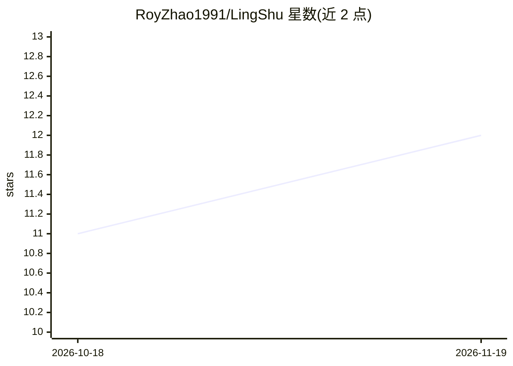

# RoyZhao1991/LingShu

⭐ 12 · Rust · Apache-2.0 · 推送 2026-10-08 · [GitHub](https://github.com/RoyZhao1991/LingShu) · [官网](https://royzhao1991.github.io/LingShu/) · 个人维护 · 中文 README

**macOS 本地优先的通用执行 agent，交付经核验的代码与文档**

Apache-2.0 的 macOS 原生执行 agent，位于 Codex / Claude Code 类别：一次请求可结构化生成可编辑的 PPTX、DOCX、PDF、代码与脚本，经独立 checker 核验后落盘交付。模型后端可替换（OpenAI/Claude/DeepSeek/MiniMax 或兼容端点），运行时、编排、记忆与工件账本保留在本地。支持 Computer Use（经授权操作 macOS 应用）、隔离 worker 会话、人工介入暂停/恢复与 CLI 控制。项目为 alpha 阶段，Windows 为技术预览且不含直接电脑控制。

## 筛选速览

| 维度 | 判定 | 备注 |
|---|---|---|
| AI 角色 | `ai-native` | 本体是模型或模型工具 |
| 许可风险 | `permissive` | Apache-2.0 |
| 部署形态 | `desktop` | 安装包/桌面程序 |
| 模型依赖 | locked-api |  |
| 硬件要求 | — | 无带数字的原话,不猜 |
| 安装摩擦 | `low` | 无编译、无系统依赖或容器化 |
| 成熟度 | `idea` | |

## 能力要点

- 模型后端可替换：OpenAI、Anthropic、DeepSeek、MiniMax 或自定义兼容端点
- 真实可编辑的 PPTX/DOCX/PDF 交付，经工件账本注册与独立 checker 核验
- Computer Use：读取辅助功能快照并通过原生 macOS API 操作授权应用
- brew 签名 DMG 安装，附带 lingshu CLI 与本地 HTTP JSON-RPC 控制面

## 适用场景

- 一次简报生成可编辑的汇报幻灯片与文档并自动核验
- 本地代码编辑、运行测试与检查 Git 变更的自动化执行
- 经授权的 macOS 应用操作与办公流程自动化

## 场景标签

`AI 助手` `编码 Agent` `GUI 自动化` · 领域:效率与自动化

## 证据(README 行号)

> L3:  A fully open-source, model-agnostic execution agent in the Codex / Claude Code category.
> L4:  Code is one deliverable, not the boundary: ship verified software, presentations, documents, and authorized Mac wor
> L98: |Model gateway|OpenAI Responses / Chat Completions, Anthropic Messages, streaming, and custom compatible endpoints|

## 星数曲线

2026-10-18 11 → 2026-11-19 12（+1）

---
*卡片 v1 · prompt 1.4 · 生成 2026-11-18 · 置信度 high · 依据 README sha `b4b6401b4a0f` · [字段定义](../../DATASET.md)*
