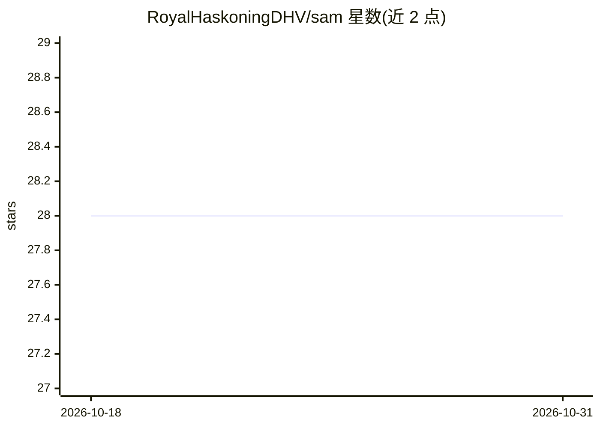

# RoyalHaskoningDHV/sam

⭐ 28 · Python · MIT · 推送 2026-07-07 · [GitHub](https://github.com/RoyalHaskoningDHV/sam) · 组织维护

**面向资产管理的 Python 时序分析与异常检测、预测库**

SAM（Smart Asset Management）是由 Royal HaskoningDHV 维护的 Python 包，提供时间序列分析、异常检测与预测功能，内含 MLPTimeseriesRegressor 等模型和特征工程组件（SimpleFeatureEngineer），并附带示例数据集（如 rainbow_beach）与示例 notebook。通过 pip 安装，支持 plotting、data_science、data_engineering 等可选依赖组；配置文件目前仅存储 API 凭据（如 regenradar 数据源）。文档发布于 ReadTheDocs，更新频繁。

## 筛选速览

| 维度 | 判定 | 备注 |
|---|---|---|
| AI 角色 | `ai-native` | 本体是模型或模型工具 |
| 许可风险 | `permissive` | MIT |
| 部署形态 | `library` | 以包/库形式分发 |
| 模型依赖 | — | README 未给出锁定关系 |
| 硬件要求 | — | 无带数字的原话,不猜 |
| 安装摩擦 | `low` | 无编译、无系统依赖或容器化 |
| 成熟度 | — | 结构信号不足 |

## 能力要点

- 提供 MLPTimeseriesRegressor 等时序模型与 SimpleFeatureEngineer 特征工程组件
- 内置示例数据集（load_rainbow_beach）与示例 notebook
- 可选依赖分组：plotting / data_science / data_engineering / all
- 支持通过 .config 配置文件存储 API 凭据（如 regenradar 数据源）

## 适用场景

- 对资产相关时间序列数据做异常检测
- 构建时间序列预测模型并配合特征工程使用
- 数据科学/数据工程团队按需安装对应依赖组使用

## 场景标签

`数据分析` · 领域:效率与自动化

## 证据(README 行号)

> L10: SAM (Smart Asset Management) is a Python package for *timeseries analysis*, *anomaly detection* and *forecasting*.
> L37: from sam.models import MLPTimeseriesRegressor

## 星数曲线

2026-10-18 28 → 2026-10-31 28（+0）

---
*卡片 v1 · prompt 1.4 · 生成 2026-10-26 · 置信度 high · 依据 README sha `786204824f88` · [字段定义](../../DATASET.md)*
