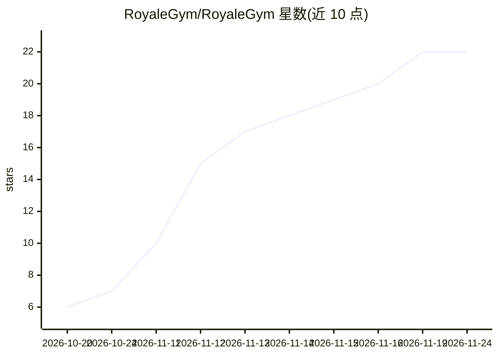

# RoyaleGym/RoyaleGym

⭐ 24 · Python · MIT · 推送 2026-11-21 · [GitHub](https://github.com/RoyaleGym/RoyaleGym) · [官网](https://royalegym.github.io/RoyaleGym/) · 个人维护

**用 Python 训练 Clash Royale 机器人对战的 RL 环境库**

提供 Gymnasium 与 PettingZoo API 的 Clash Royale 对战环境：内置确定性 Rust 引擎、每秒 20 tick、2305 个动作空间的多人对战，附带可视化回放工具与训练流程。README 建议先从真实对局克隆人类玩家行为作为起点，纯试错学习效果有限。支持 pip 一键安装，无需 Rust 编译器与游戏文件，Windows+NVIDIA 需先装 PyTorch。MIT 许可。

## 筛选速览

| 维度 | 判定 | 备注 |
|---|---|---|
| AI 角色 | `ai-ecosystem` | LLM/agent 周边工具 |
| 许可风险 | `permissive` | MIT |
| 部署形态 | `library` | 以包/库形式分发 |
| 模型依赖 | — | README 未给出锁定关系 |
| 硬件要求 | — | 无带数字的原话,不猜 |
| 安装摩擦 | `low` | 无编译、无系统依赖或容器化 |
| 成熟度 | — | 结构信号不足 |

## 能力要点

- Gymnasium 与 PettingZoo 双 API，Rust 确定性引擎，50ms tick，2305 动作空间
- play_battle 一行运行随机对战并保存 msgpack 回放，royaleviser 观看
- 提供从真实对局克隆人类玩家行为的入门路径

## 适用场景

- 我在 Python 里训练自己的 Clash Royale 对战 bot
- 做多人强化学习/博弈实验的轻量环境
- 观战与回放 bot 对局分析行为

## 场景标签

`强化学习` `多智能体` · 领域:Agent 开发

## 证据(README 行号)

> L7:  APIs: Gymnasium and PettingZoo Engine: Rust, deterministic Tick: 50 ms, 20 per second Action space: 2305 moves
> L9: **Make a Clash Royale bot in Python.** You write what your bot should want; this gives it the

## 星数曲线

2026-10-20 6 → 2026-11-24 22（+16）

---
*卡片 v1 · prompt 1.4 · 生成 2026-11-18 · 置信度 high · 依据 README sha `17002575c20e` · [字段定义](../../DATASET.md)*
