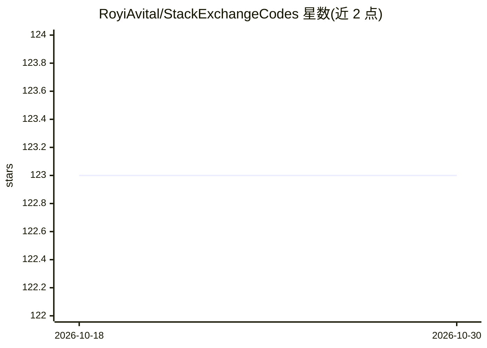

# RoyiAvital/StackExchangeCodes

⭐ 123 · MATLAB · NOASSERTION · 推送 2026-09-13 · [GitHub](https://github.com/RoyiAvital/StackExchangeCodes) · 个人维护

**StackExchange 数学/图像处理/信号处理问题解答配套代码合集**

个人维护的代码合集，收录作者 Royi Avital 在 StackExchange 网络上回答问题所配套的 MATLAB/Julia 等代码，主题覆盖图像处理、凸优化、信号处理、机器学习与数学。代码仅供教育目的、非商业使用（CC BY-NC 4.0），其他用途需联系作者。README 未提供统一安装或运行方式，各代码随对应回答独立存在，并列出尚未完成的待办主题。

## 筛选速览

| 维度 | 判定 | 备注 |
|---|---|---|
| AI 角色 | `ai-knowledge` | 知识聚合/清单类 |
| 许可风险 | `none` | NOASSERTION |
| 部署形态 | `None` |  |
| 模型依赖 | — | README 未给出锁定关系 |
| 硬件要求 | — | 无带数字的原话,不猜 |
| 安装摩擦 | `low` | 无编译、无系统依赖或容器化 |
| 成熟度 | — | 结构信号不足 |

## 能力要点

- 收录 StackExchange 回答配套的图像处理/优化/信号处理代码
- 涵盖 MATLAB、Julia 等语言的算法实现片段
- 以 CC BY-NC 4.0 授权，限教育与非商业用途

## 适用场景

- 查阅 StackExchange 答案对应的可运行代码
- 学习图像滤波、最小二乘、卡尔曼滤波等算法实现
- 按待办清单寻找可复现的算法示例

## 场景标签

`教程课程` · 领域:学习与行业

## 证据(README 行号)

> L7: # StackExchange Codes
> L8: Codes related to answers by Royi Avital on StackExchange Network.

## 星数曲线

2026-10-18 123 → 2026-10-30 123（+0）

---
*卡片 v1 · prompt 1.4 · 生成 2026-10-23 · 置信度 mid · 依据 README sha `8cb1506256c9` · [字段定义](../../DATASET.md)*
