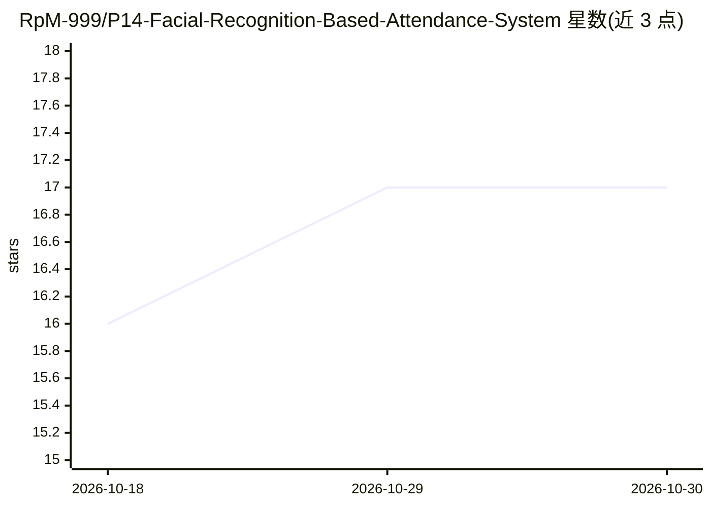

# RpM-999/P14-Facial-Recognition-Based-Attendance-System

⭐ 17 · Python · MIT · 推送 2026-04-05 · [GitHub](https://github.com/RpM-999/P14-Facial-Recognition-Based-Attendance-System) · 个人维护

**面向教育机构的人脸识别考勤系统，含管理与数据仓库**

用 FaceNet-PyTorch 生成 512 维人脸嵌入、MTCNN 检测人脸，在 Qdrant 向量库做余弦相似度匹配，通过摄像头实时识别学生并记录考勤到 Google Sheets。提供 Streamlit 管理面板（Supabase Auth 认证、部门与学生管理、报表邮件），并以 Databricks 数据仓库（Bronze/Silver/Gold 分层）做分析。面向学校等教育机构；部署需配置 Supabase、Qdrant、Google Sheets API 与 SMTP 等多项外部服务，代码通过 git clone + pip 安装运行。

## 筛选速览

| 维度 | 判定 | 备注 |
|---|---|---|
| AI 角色 | `ai-native` | 本体是模型或模型工具 |
| 许可风险 | `permissive` | MIT |
| 部署形态 | `library` | 以包/库形式分发 |
| 模型依赖 | — | README 未给出锁定关系 |
| 硬件要求 | — | 无带数字的原话,不猜 |
| 安装摩擦 | `medium` | 含编译或系统依赖之一 |
| 成熟度 | — | 结构信号不足 |

## 能力要点

- FaceNet 512 维嵌入 + Qdrant 余弦相似度毫秒级人脸匹配
- Streamlit 管理面板：部门/学生/注册管理与角色访问控制
- 考勤自动写入 Google Sheets，HTML 报表邮件发送
- Databricks 星型模式数据仓库（Bronze/Silver/Gold）做分析

## 适用场景

- 学校用摄像头人脸识别自动记录学生考勤
- 管理员批量管理学生人脸数据并生成部门报表
- 把考勤数据入仓做历史分析与出勤率统计

## 场景标签

`人脸识别` · 领域:感知与多模态

## 证据(README 行号)

> L11: - ✅ **Real-time Facial Recognition** using FaceNet deep learning model with MTCNN face detection
> L120: - **FaceNet-PyTorch**: Pre-trained FaceNet model for generating 512-dimensional face embeddings

## 星数曲线

2026-10-18 16 → 2026-10-30 17（+1）

---
*卡片 v1 · prompt 1.4 · 生成 2026-10-30 · 置信度 high · 依据 README sha `1c225d4798ef` · [字段定义](../../DATASET.md)*
