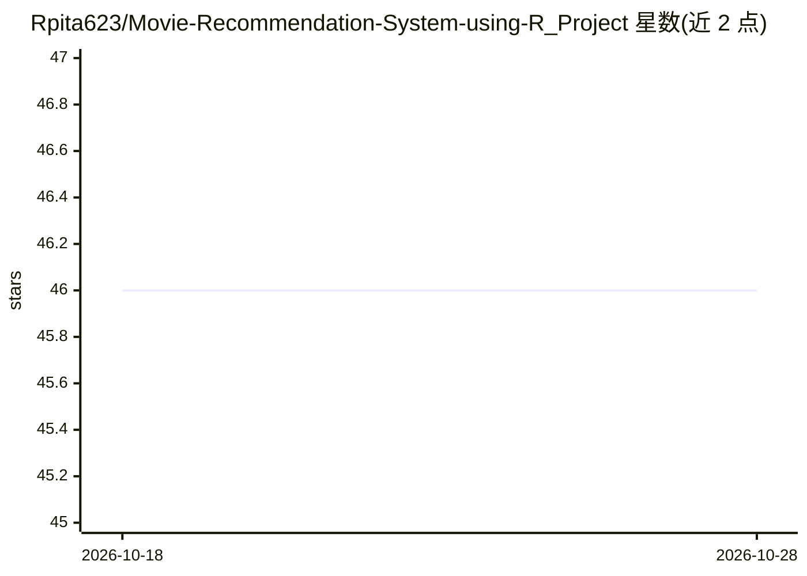

# Rpita623/Movie-Recommendation-System-using-R_Project

⭐ 46 · R · 推送 2026-06-08 · [GitHub](https://github.com/Rpita623/Movie-Recommendation-System-using-R_Project) · 个人维护

**R 实现的电影推荐系统：基于 MovieLens 的物品协同过滤**

使用 R 语言实现的电影推荐系统项目：读取 MovieLens 数据集（105339 条评分、10329 部电影），构建 Item Based Collaborative Filter 向用户推荐电影。流程包括数据预处理（userId/movieId 类型处理、电影类型 one-hot 编码生成矩阵、构建按类型检索电影的 search matrix），依赖 recommenderlab、ggplot2、data.table、reshape2 四个库。作者定位为学习型项目，用于理解推荐系统的运作方式并实践 R 与数据科学技能。

## 筛选速览

| 维度 | 判定 | 备注 |
|---|---|---|
| AI 角色 | `ai-native` | 本体是模型或模型工具 |
| 许可风险 | `none` | — |
| 部署形态 | `None` |  |
| 模型依赖 | — | README 未给出锁定关系 |
| 硬件要求 | — | 无带数字的原话,不猜 |
| 安装摩擦 | `low` | 无编译、无系统依赖或容器化 |
| 成熟度 | — | 结构信号不足 |

## 能力要点

- 基于 Item Based Collaborative Filter 的电影推荐引擎
- 使用 MovieLens 数据集（105339 条评分 / 10329 部电影）
- 类型 one-hot 编码与 search matrix 支持按类型检索电影
- 依赖 recommenderlab、ggplot2、data.table、reshape2

## 适用场景

- 学习推荐系统与协同过滤的实现原理
- 练习 R 语言的数据预处理与数据科学流程
- 在 MovieLens 数据上生成电影推荐

## 场景标签

`推荐系统` · 领域:学习与行业

## 证据(README 行号)

> L4: The main goal of this machine learning project is to build a recommendation engine that recommends movies to users. 
> L7: I have used the MovieLens Dataset. That data I have used consists of 105339 ratings in the ```ratings.csv``` file, a
> L10: ```recommenderlab```, ```ggplot2```, ```data.table``` and ```reshape2```.

## 星数曲线



2026-10-18 46 → 2026-10-28 46（+0）


---
*卡片 v1 · prompt 1.4 · 生成 2026-10-25 · 置信度 high · 依据 README sha `6901114362ae` · [字段定义](../../DATASET.md)*
