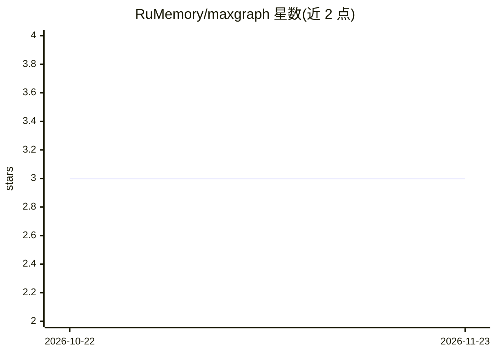

# RuMemory/maxgraph

⭐ 3 · Python · NOASSERTION · 推送 2026-11-04 · [GitHub](https://github.com/RuMemory/maxgraph) · [官网](https://rezon-ai.ru) · 个人维护

**AI agent 的本地持久化记忆：MCP 服务器+知识图谱**

以 MCP 服务器与 REST API 形式运行的项目记忆服务：agent 在工作中自动记录决策、bug、未完成任务与会话摘要，按项目分库存储为本机文本文件，离线可用；新会话通过项目摘要快速恢复上下文，宣称减少约 43% token 消耗。提供仪表盘查看、检索（语义搜索）与 NDJSON 导出。支持 Claude Code/Cursor/VS Code/Cline 等客户端一键接入；7 天免费试用后一次性付费，BSL-1.1 许可，四年后转为 MIT。

## 筛选速览

| 维度 | 判定 | 备注 |
|---|---|---|
| AI 角色 | `ai-ecosystem` | LLM/agent 周边工具 |
| 许可风险 | `none` | NOASSERTION |
| 部署形态 | `None` |  |
| 模型依赖 | — | README 未给出锁定关系 |
| 硬件要求 | — | 无带数字的原话,不猜 |
| 安装摩擦 | `low` | 无编译、无系统依赖或容器化 |
| 成熟度 | — | 结构信号不足 |

## 能力要点

- MCP server + REST API 双接入方式，兼容多种 agent 客户端
- 本地存储为普通文本文件，离线工作，可 NDJSON 导出
- 按项目划分记忆，新会话自动注入项目摘要
- 仪表盘支持记忆地图、搜索与逐条修改/删除

## 适用场景

- 让 Claude Code/Cursor 等编码 agent 跨会话记住项目决策与未完成事项
- 多个 agent 共享同一份项目上下文
- 本地保存记忆数据、需要可导出可审计的场景

## 场景标签

`Agent 记忆` · 领域:Agent 开发

## 证据(README 行号)

> L16: Память ChatGPT и Claude помнит тебя: имя, вкусы, привычки. MaxGraph помнит твою **работу** — решения, баги, открыты
> L87: |Cline / Continue|MCP streamable-http + Bearer|
> L130: BSL-1.1: исходный код открыт. Личное и внутреннее использование — бесплатно. Продажа MaxGraph как сервиса — по ком

## 星数曲线

2026-10-22 3 → 2026-11-23 3（+0）

---
*卡片 v1 · prompt 1.4 · 生成 2026-11-22 · 置信度 high · 依据 README sha `b43526b2d524` · [字段定义](../../DATASET.md)*
