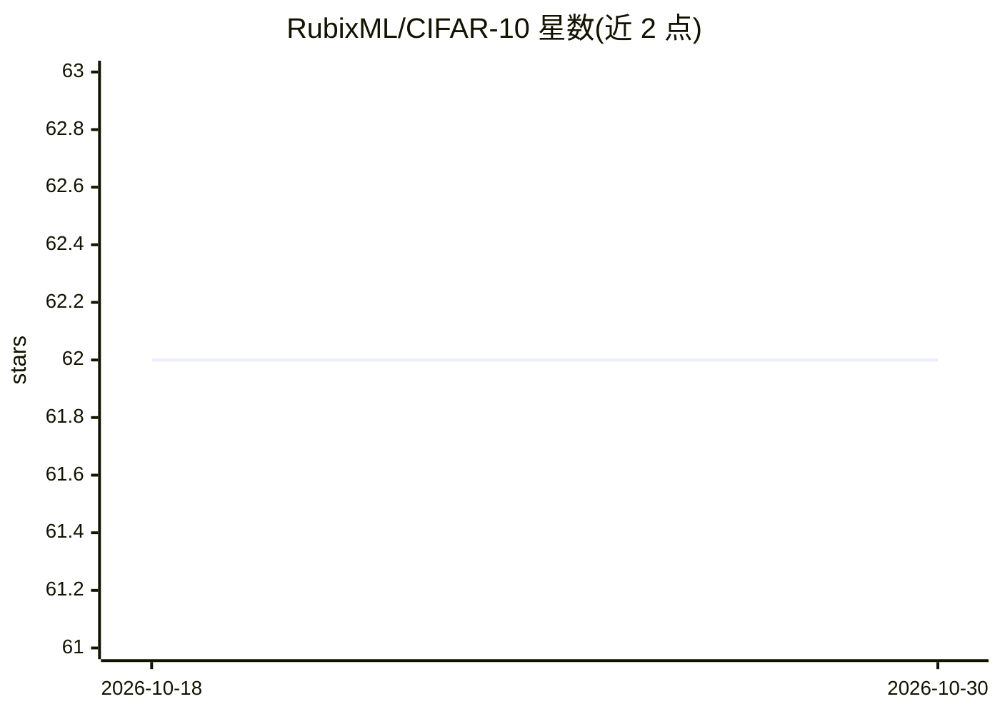

# RubixML/CIFAR-10

⭐ 62 · PHP · MIT · 推送 2026-10-08 · [GitHub](https://github.com/RubixML/CIFAR-10) · [官网](https://rubixml.github.io/ML) · 组织维护

**用 Rubix ML 在 CIFAR-10 上训练图像识别神经网络的教程工程**

基于 Rubix ML 库的 PHP 教程示例工程：用 GD 扩展读取 60,000 张 32x32 PNG 图像，经图像缩放、RGB 向量化、Z-Score 标准化等 Pipeline 预处理，训练多层感知机（Dense/Activation/SiLU/Batch Norm 层）做 10 类图像分类。采用分块训练（每块 10,000 张）应对内存限制，配合数据增强、验证集早停与梯度累积，训练好的模型持久化到 model.rbx。面向学习 Rubix ML 与 PHP 机器学习的开发者，要求 PHP 8.3+ 与 GD 扩展，可选 Tensor 扩展提升速度。

## 筛选速览

| 维度 | 判定 | 备注 |
|---|---|---|
| AI 角色 | `ai-knowledge` | 知识聚合/清单类 |
| 许可风险 | `permissive` | MIT |
| 部署形态 | `None` |  |
| 模型依赖 | — | README 未给出锁定关系 |
| 硬件要求 | — | 无带数字的原话,不猜 |
| 安装摩擦 | `medium` | 含编译或系统依赖之一 |
| 成熟度 | — | 结构信号不足 |

## 能力要点

- Pipeline 预处理：ImageResizer/ImageVectorizer/Z Scale Standardizer 并可持久化
- 分块 partial() 训练支持超出内存的数据集，含梯度累积与早停
- 训练时数据增强（翻转、亮度/对比度/饱和度扰动）
- 模型与转换器状态持久化到 model.rbx / transformer.rbx

## 适用场景

- 学习用 Rubix ML 构建图像分类神经网络的完整流程
- 作为 PHP 机器学习项目的可运行示例代码
- 了解分块训练、数据增强与早停的实践用法

## 场景标签

`教程课程` `目标检测` · 领域:学习与行业

## 证据(README 行号)

> L3: CIFAR-10 (short for *Canadian Institute For Advanced Research*) is a famous dataset consisting of 60,000 32 x 32 col
> L99: The Multilayer Perceptron classifier is a type of neural network model we'll train to recognize images in the CIFAR

## 星数曲线

2026-10-18 62 → 2026-10-30 62（+0）

---
*卡片 v1 · prompt 1.4 · 生成 2026-10-24 · 置信度 high · 依据 README sha `d1ccbc3b29c8` · [字段定义](../../DATASET.md)*
