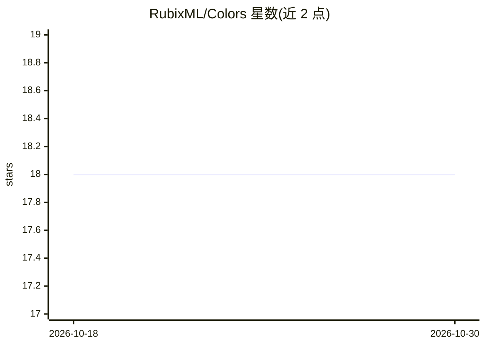

# RubixML/Colors

⭐ 18 · PHP · MIT · 推送 2026-10-08 · [GitHub](https://github.com/RubixML/Colors) · [官网](https://rubixml.org) · 组织维护

**PHP K Means 聚类教学项目：合成颜色数据演示聚类**

Rubix ML 官方教程示例工程：用数据集生成器合成 10 种颜色（RGB 特征）共 5000 条样本，按 80/20 分层切分后训练 K Means 聚类器（k=10，Mini Batch 梯度下降最小化 inertia），随后输出预测、Contingency Table 交叉验证报告与 V-Measure 指标。面向学习 PHP 机器学习库 Rubix ML 的开发者，通过 composer create-project 一键克隆，运行 php train.php 即可复现全部流程。代码 MIT 许可，教程文本 CC BY-NC 4.0。

## 筛选速览

| 维度 | 判定 | 备注 |
|---|---|---|
| AI 角色 | `ai-knowledge` | 知识聚合/清单类 |
| 许可风险 | `permissive` | MIT |
| 部署形态 | `None` |  |
| 模型依赖 | — | README 未给出锁定关系 |
| 硬件要求 | — | 无带数字的原话,不猜 |
| 安装摩擦 | `low` | 无编译、无系统依赖或容器化 |
| 成熟度 | — | 结构信号不足 |

## 能力要点

- 合成 10 色 RGB 数据集并分层切分为训练/测试集
- K Means 训练与 inertia 损失导出（CSV）
- Contingency Table 聚类报告与 V-Measure 指标评估
- composer 一键创建工程并运行 train.php 复现

## 适用场景

- 学习 Rubix ML 库的 K Means 聚类完整流程
- 了解聚类任务的交叉验证与评估方法
- 作为 PHP 机器学习入门练习项目

## 场景标签

`教程课程` · 领域:学习与行业

## 证据(README 行号)

> L3: The K Means algorithm is a popular unsupervised learner for clustering samples. In this tutorial, we'll generate a s
> L21: In machine learning, synthetic data are often used for demonstration purposes or to augment a smaller dataset with 

## 星数曲线

2026-10-18 18 → 2026-10-30 18（+0）

---
*卡片 v1 · prompt 1.4 · 生成 2026-10-29 · 置信度 high · 依据 README sha `b4dd6c22283c` · [字段定义](../../DATASET.md)*
