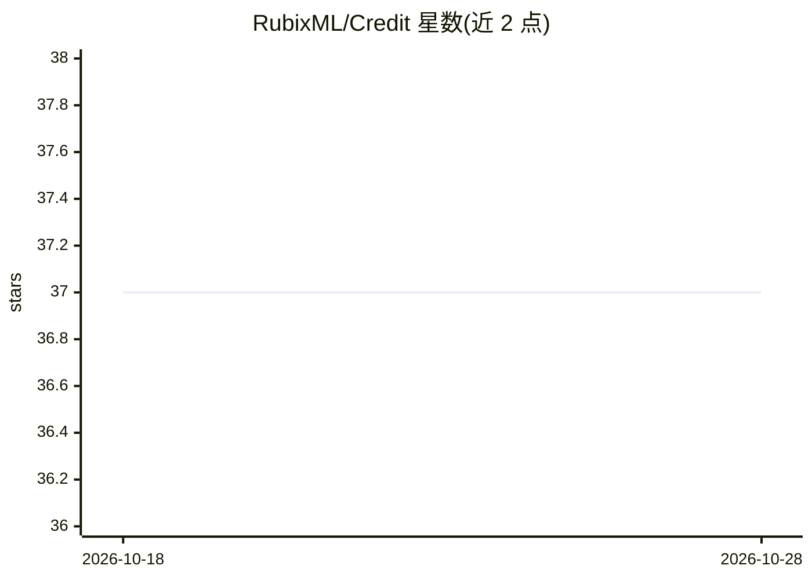

# RubixML/Credit

⭐ 37 · PHP · MIT · 推送 2026-10-20 · [GitHub](https://github.com/RubixML/Credit) · [官网](https://rubixml.org) · 组织维护

**用逻辑回归预测信用卡违约的 Rubix ML 示例项目**

Rubix ML 官方示例工程：基于 30,000 条台湾信用卡客户数据，训练 Logistic Regression 二分类器预测客户下月违约概率。教程覆盖 CSV 数据抽取、缺失值填补、One Hot 编码、标准化、分层切分训练/测试集、训练与交叉验证报告（Accuracy/F1/混淆矩阵），并用 t-SNE 流形学习可视化数据集、以 Trustworthiness 指标评估嵌入质量。通过 Composer 创建项目，需 PHP 8.3+，推荐安装 Tensor 扩展加速训练。面向学习机器学习与 PHP 数据科学的开发者。

## 筛选速览

| 维度 | 判定 | 备注 |
|---|---|---|
| AI 角色 | `ai-native` | 本体是模型或模型工具 |
| 许可风险 | `permissive` | MIT |
| 部署形态 | `None` |  |
| 模型依赖 | — | README 未给出锁定关系 |
| 硬件要求 | — | 无带数字的原话,不猜 |
| 安装摩擦 | `low` | 无编译、无系统依赖或容器化 |
| 成熟度 | — | 结构信号不足 |

## 能力要点

- Logistic Regression 二分类训练与预测完整流程
- Multiclass Breakdown 与 Confusion Matrix 交叉验证报告（示例达 83% 准确率）
- t-SNE 流形学习可视化与 Trustworthiness 嵌入评估
- 缺失值填补、One Hot 编码、Z Score 标准化等预处理流水线示例

## 适用场景

- 学习用 PHP 和 Rubix ML 完成一个分类任务全流程
- 作为 Rubix ML 库各 API 的参考实现
- 了解数据预处理、交叉验证与数据集可视化的做法

## 场景标签

`教程课程` · 领域:学习与行业

## 证据(README 行号)

> L1: # Rubix ML - Credit Card Default Predictor
> L3: An example Rubix ML project that predicts the probability of a customer defaulting on their credit card bill next mo
> L25: The dataset provided to us contains 30,000 labeled samples from customers of a Taiwanese credit card issuer. Our ob

## 星数曲线

2026-10-18 37 → 2026-10-28 37（+0）

---
*卡片 v1 · prompt 1.4 · 生成 2026-10-25 · 置信度 high · 依据 README sha `e3ed32af8be6` · [字段定义](../../DATASET.md)*
