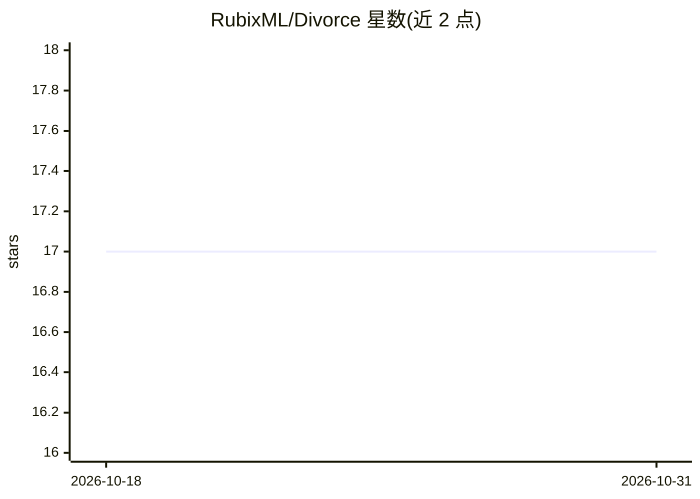

# RubixML/Divorce

⭐ 17 · PHP · MIT · 推送 2026-10-08 · [GitHub](https://github.com/RubixML/Divorce) · [官网](https://rubixml.github.io/ML) · 组织维护

**用 KNN 算法预测离婚概率的 Rubix ML 示例项目**

基于 Rubix ML 库的机器学习教程项目：使用 K Nearest Neighbors 算法，根据 54 道关于伴侣的问卷回答预测离婚与否，附带 171 条人工标注样本用于训练。通过 Composer 以 create-project 方式安装本地运行，要求 PHP 8.3 及以上。数据集来自土耳其多所大学研究者，教程采用 CC BY-NC 4.0 许可，代码为 MIT 许可。

## 筛选速览

| 维度 | 判定 | 备注 |
|---|---|---|
| AI 角色 | `ai-native` | 本体是模型或模型工具 |
| 许可风险 | `permissive` | MIT |
| 部署形态 | `None` |  |
| 模型依赖 | — | README 未给出锁定关系 |
| 硬件要求 | — | 无带数字的原话,不猜 |
| 安装摩擦 | `low` | 无编译、无系统依赖或容器化 |
| 成熟度 | — | 结构信号不足 |

## 能力要点

- KNN 分类器预测离婚概率
- 内置 171 条人工标注问卷样本
- Composer 一键创建项目

## 适用场景

- 学习 Rubix ML 库的分类与交叉验证用法
- 作为 KNN 教程项目动手实践机器学习流程

## 场景标签

`教程课程` · 领域:学习与行业

## 证据(README 行号)

> L3: Use the K Nearest Neighbors algorithm to predict who of your friends will stay married or get a divorce based on the
> L10: $ composer create-project rubix/divorce

## 星数曲线

2026-10-18 17 → 2026-10-31 17（+0）

---
*卡片 v1 · prompt 1.4 · 生成 2026-10-30 · 置信度 high · 依据 README sha `6c61633bf994` · [字段定义](../../DATASET.md)*
