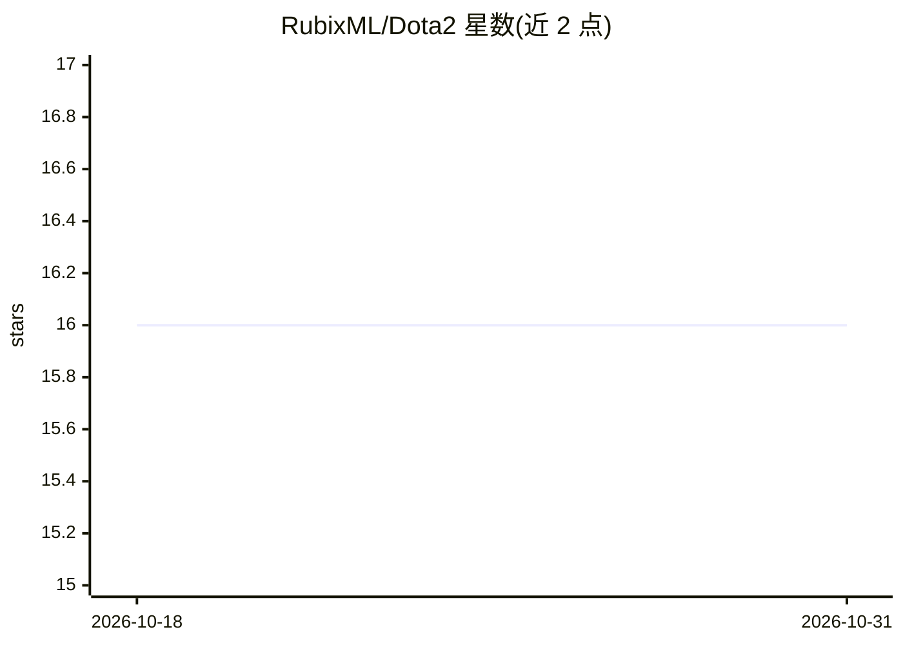

# RubixML/Dota2

⭐ 16 · PHP · MIT · 推送 2026-10-08 · [GitHub](https://github.com/RubixML/Dota2) · [官网](https://rubixml.github.io/ML) · 组织维护

**Dota 2 对局胜负预测教程：PHP 朴素贝叶斯分类器**

基于 Rubix ML 库的机器学习教程项目：用 102,944 场真实对局数据（英雄选择与胜负标签），训练朴素贝叶斯分类器根据双方英雄阵容预测获胜队伍。教程覆盖数据读取（CSV 流式提取）、模型训练、PersistentModel 将训练结果持久化为 dota.rbx 文件、以及在 10,000+ 条留出测试集上用 MulticlassBreakdown 与 ConfusionMatrix 评估准确率/精确率/召回率。以 PHP 项目形式提供，通过 Composer 安装，需 PHP 8.3+。代码 MIT 许可，教程文本 CC BY-NC 4.0。

## 筛选速览

| 维度 | 判定 | 备注 |
|---|---|---|
| AI 角色 | `ai-native` | 本体是模型或模型工具 |
| 许可风险 | `permissive` | MIT |
| 部署形态 | `None` |  |
| 模型依赖 | — | README 未给出锁定关系 |
| 硬件要求 | — | 无带数字的原话,不猜 |
| 安装摩擦 | `low` | 无编译、无系统依赖或容器化 |
| 成熟度 | — | 结构信号不足 |

## 能力要点

- 基于 102,944 场对局数据的朴素贝叶斯英雄阵容胜负分类
- PersistentModel 将训练模型保存到磁盘供其他进程加载复用
- 测试集评估输出 MulticlassBreakdown 与 ConfusionMatrix 报告（report.json）
- 提供 train/validate 完整流程脚本（composer train / composer test）

## 适用场景

- 学习用 PHP 与 Rubix ML 完成分类模型训练与评估的完整流程
- 了解模型持久化保存与跨进程加载的做法
- 基于英雄阵容数据预测 Dota 2 对局胜负

## 场景标签

`教程课程` · 领域:学习与行业

## 证据(README 行号)

> L3: Dota 2 is a popular multiplayer online battle arena (MOBA) game that puts 10 players divided into 2 teams against ea
> L21: Our crystal ball of choice is Naive Bayes, a classifier that counts how often each hero shows up on a winning team 

## 星数曲线

2026-10-18 16 → 2026-10-31 16（+0）

---
*卡片 v1 · prompt 1.4 · 生成 2026-10-30 · 置信度 high · 依据 README sha `c946f384fa6a` · [字段定义](../../DATASET.md)*
